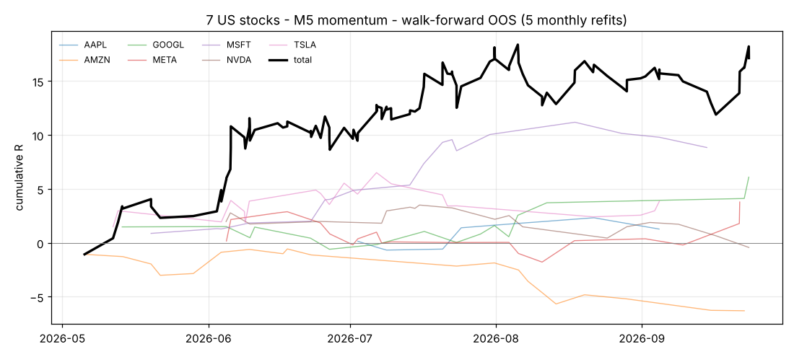
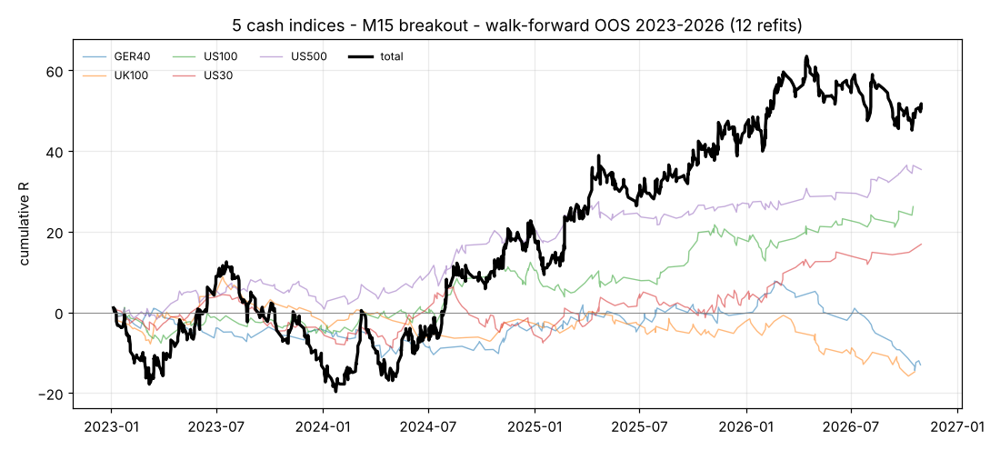

# Relatório — XAUJPY, 7 ações e 5 índices

**Pedido:** (1) adaptar o scalper inicial do XAUUSD (`mql5/ScalperXG.mq5`) ao
XAUJPY e otimizá-lo em loop até aos resultados pretendidos; (2) criar dois
scalpers MT5 multi-símbolo, um para as 7 principais ações (AAPL, MSFT, NVDA,
AMZN, GOOGL, META, TSLA) e outro para os 5 principais índices (US500, US100,
US30, GER40, UK100), e otimizá-los em loop.

**Resultados pretendidos.** Usei os alvos do estudo XAUUSD original: profit
factor ≥ 1,2, win rate ≥ 50% e pelo menos 100 trades. Para os cabazes com pouco
histórico, os 100 trades contam como **100 trades/ano**, pro-rata ao período
testado. Isto é mais exigente que o original, que pedia 100 trades no total.

**Onde foi otimizado.** Este ambiente é um contentor Linux sem MetaTrader 5 e
sem acesso a servidores de corretoras, por isso não consigo correr o Strategy
Tester do MT5. Toda a otimização foi feita no backtester Python do repositório,
que replica a lógica dos EAs: mesmos indicadores (Wilder ATR/RSI/ADX), barras
fechadas, execução na abertura da barra seguinte, stop ganha ao alvo dentro da
mesma barra, e custos de spread, slippage e comissão. Cada EA vem com um `.set`
cujas linhas `Y` delimitam a re-otimização no MT5 com os ticks reais da tua
corretora. Esse é o passo seguinte que recomendo.

## Resumo

| EA | Símbolos | TF | Família | Teste fora da amostra | Trades | WR | PF | Exp. | t | Alvos |
|---|---|---|---|---|---|---|---|---|---|---|
| [`ScalperXAUJPY.mq5`](../mql5/ScalperXAUJPY.mq5) | XAUJPY | M30 | momentum | holdout congelado jan/2025–out/2026 | 68 | **61,8%** | **1,37** | +0,099R | 1,01 | PF ✔ WR ✔ trades ✘ (68 < 100) |
| | | | | walk-forward 2021–2026, 17 reajustes | 342 | 52,3% | 0,86 | −0,044R | −1,12 | ✘ |
| [`ScalperStocks7.mq5`](../mql5/ScalperStocks7.mq5) | 7 ações | M5 | momentum | walk-forward mai–set/2026, 5 reajustes mensais | 122 | **54,9%** | **1,39** | +0,140R | 1,50 | **✔ ✔ ✔** (precisa ≥ 40) |
| [`ScalperIndices5.mq5`](../mql5/ScalperIndices5.mq5) | 5 índices | M15 | breakout | walk-forward jan/2023–out/2026, 12 reajustes | 1079 | 46,3% | 1,10 | +0,047R | 1,34 | trades ✔ PF ✘ WR ✘ |
| | só US500 + US100 + US30 (subconjunto escolhido *a posteriori*) | | | o mesmo walk-forward | 704 | 49,6% | **1,25** | +0,111R | **2,59** | PF ✔ trades ✔ WR ≈ (49,6%) |

**Leitura honesta:**
- **Nenhum resultado é estatisticamente significativo.** Todos têm t < 2, o que
  quer dizer que podem ser sorte.
- **Os alvos foram atingidos depois de várias voltas do loop**, cada uma a
  escolher a melhor entre várias opções. Isto inflaciona os números.
- **São candidatos para testar em demo ou no Strategy Tester do MT5**, não
  sistemas comprovados.

O dado que mais pesa contra o XAUJPY é o walk-forward negativo de 2021–2026. Do
lado positivo, os parâmetros congelados ganham em 7 de 8 anos.

O resultado mais sólido do relatório é o breakout M15 nos índices americanos:
quase 4 anos fora da amostra, 704 trades, t = 2,59. Só que essa restrição aos
índices dos EUA foi decidida depois de ver os resultados por índice.

---

## 1. Dados (reais)

| | Fonte | Período | Barras M1 |
|---|---|---|---|
| XAUJPY | OANDA M1 (arquivo público `bunqii/OANDA_XAUJPY_GoldJPY`) | jan/2019 – out/2026 | ~2,7 M |
| US500, US100, US30, GER40, UK100 | OANDA M1 (`bunqii/OANDA_<índice>`) | jan/2021 – out/2026 | ~2 M cada |
| AAPL, MSFT, NVDA, AMZN, GOOGL¹, META, TSLA | amostras gratuitas getdata.finance, união do histórico git | 2/fev – 25/set/2026 | ~64 mil cada (só sessão regular) |

¹ Só a linha GOOG está publicada. Acompanha GOOGL quase tick a tick.

Para descarregar: `python3 scripts/fetch_metals.py --symbols XAUJPY US100 US500 US30 GER40 UK100`
e `python3 scripts/fetch_stocks.py`. **As ações só têm cerca de 8 meses de
dados.** Não encontrei histórico intradiário mais longo de acesso livre que este
ambiente consiga descarregar. Isso é a maior limitação deste relatório.

## 2. Custos modelados (round-trip)

| | spread | outros | custo / ATR M5 | custo / ATR M15 |
|---|---|---|---|---|
| XAUJPY | 2,0 bp (¥120 a ¥600 000) | slippage 0,3 + 0,7 bp | 0,38 | 0,22 |
| Índices | 0,6–1,25 bp (US30 2,5 pt, US100 1,5, GER40 1,5, US500 0,5, UK100 1,0) | slippage 0,2 + 0,5 bp | 0,17–0,27 | 0,11–0,17 |
| Ações | 2 bp | comissão US$0,02/ação por lado; slippage 0,5 + 1 bp | 0,20–0,33 | 0,12–0,20 |

Todos os custos escalam com o preço (bp) e alargam fora de horas e em
volatilidade. É o mesmo modelo conservador do estudo XAUUSD.
`reports/new_diagnose.json` tem o detalhe por timeframe.

## 3. XAUJPY: o scalper XAUUSD adaptado

O EA é o mesmo motor do `ScalperXG` (as mesmas famílias, filtro de Efficiency
Ratio, stop ATR e gestão de trade), com três mudanças: especificação XAUJPY
(ponto = ¥1), stop mínimo em bp do preço, e verificação de símbolo.

**Loop de otimização**

| volta | o quê | resultado |
|---|---|---|
| 1 | timeframe × família (M5/M15/M30 × fade, bands, momentum, breakout), espaço base; ajuste 2019–22, validação 2023–24 | tudo ≈ 0R. Melhor: M30 momentum, −0,009R, PF 0,97, WR 54,7% |
| 2 | mesmo, espaço "seletivo" (entradas raras com movimentos maiores) | melhor: **M30 momentum, +0,028R, PF 1,26** (139 trades) |
| 3A | M30 momentum, walk-forward + holdout, com portões rígidos PF ≥ 1,2 e WR ≥ 50% no ajuste | holdout 65 tr, WR 53,8%, PF 1,18, +0,036R. WF PF 0,81 |
| **3B** | **o mesmo sem portões** | **holdout 68 tr, WR 61,8%, PF 1,37, +0,099R. WF PF 0,86** |
| 3C | M15 momentum com portões e mínimo de 50 trades/ano (para ter mais trades) | nenhuma configuração passou os portões em 2019–24. WF 219 tr, PF 0,95 |

M1 foi excluído logo de início: o custo é 0,9 ATR(M1).

**Parâmetros enviados (3B, ajustados uma vez em 2019–2024 e congelados):**
sessão de Londres (07–12 UTC), M30. Entra quando o movimento líquido de 6 h é
≥ 1,5 ATR com Efficiency Ratio ≥ 0,45. Stop = max(2 ATR, 0,70% do preço),
alvo 2,5R, fecho parcial a +0,6R, trailing a partir de +1R, máximo de 8 h,
2 trades/dia.

| ano | 2019 | 2020 | 2021 | 2022 | 2023 | 2024 | **2025** | **2026** |
|---|---|---|---|---|---|---|---|---|
| R (trades) | +1,7 (39) | +3,6 (39) | −3,8 (47) | +9,3 (45) | +3,3 (37) | +2,5 (47) | **+2,2 (37)** | **+4,5 (31)** |
| PF | 1,27 | 1,37 | 0,78 | 2,05 | 1,31 | 1,17 | **1,22** | **1,55** |

2019–2024 é dentro da amostra; **2025–2026 é fora da amostra**.

Sensibilidade a custos no holdout: o PF é 1,61 sem custos, 1,37 a 1×, 1,18 a
1,25× e 1,11 a 1,5×. Com spread acima de ~2,5 bp deixa de cumprir PF ≥ 1,2.

**Porque não está "resolvido":**
- **Com ~37 trades/ano não chega aos 100 trades** em 22 meses de holdout. Mais
  trades exigiam M15/M5, e aí nenhuma configuração passou os portões.
- **O walk-forward com reajuste a cada 120 dias perdeu** (PF 0,86). O que
  funciona é ajustar uma vez com 6 anos e deixar fixo; reajustar com 2 anos é
  ruído.

## 4. EA das 7 ações — `ScalperStocks7.mq5`

**Desenho:** um só gráfico negoceia as 7 ações com **um único conjunto de
parâmetros**, todos sem escala (múltiplos de ATR e R, stop mínimo em bp, sessão
relativa à bolsa). Isso é deliberado: com 8 meses de dados, parâmetros por ação
seriam sobreajuste puro. Há no máximo 1 posição por ação e 4 no total.

**Loop**

| volta | o quê | resultado |
|---|---|---|
| 1 | 32 células (M1/M5/M15/M30 × 4 famílias × base/seletivo) ajustadas em fev–mai; validação jun–jul; holdout ago–set | nenhuma passou: exigi 100 trades em 2 meses de validação, o que é irrealista |
| 2 | alvo de trades corrigido para 100/ano pro-rata, mesmas células | 1.ª a passar a validação: M1 breakout seletivo (66 tr, PF 1,55). **Falhou o holdout** (60 tr, PF 0,76) |
| 3 | o holdout já tinha sido visto, por isso passei a walk-forward contínuo: reajuste mensal (treino 90 dias, teste 30 dias, 5 meses fora da amostra) das 9 melhores células | M15 fade passou (PF 1,42), mas… |
| 3b | …o teste começava "a frio" e o filtro de volatilidade (288 barras) comia ~40% de cada mês. Corrigido com aquecimento, repetido | **M5 momentum passa: 122 tr, WR 54,9%, PF 1,39, +0,140R, t 1,50**. M15 fade cai para PF 1,04 |

**Parâmetros enviados** (reajustados na janela mais recente, jun–ago): M5,
sessão `cash_mid` (15–19 UTC, a meio da sessão americana). Entra quando o
movimento de 3 h é ≥ 1,5 ATR com Efficiency Ratio ≥ 0,60. Stop = max(2 ATR,
0,10%), alvo 2R, trailing a partir de +1R, máximo de 2 h, 4 trades/dia por ação
e 60 min de pausa.

| mês fora da amostra | mai | jun | jul | ago | set |
|---|---|---|---|---|---|
| trades | 9 | 37 | 37 | 21 | 18 |
| PF | 1,83 | 1,63 | 1,62 | 0,82 | 1,32 |

| ação | AAPL | AMZN | GOOGL | META | MSFT | NVDA | TSLA |
|---|---|---|---|---|---|---|---|
| trades | 8 | 20 | 16 | 20 | 18 | 19 | 21 |
| PF | 1,69 | **0,39** | 2,18 | 1,58 | 3,59 | 0,94 | 1,40 |

4 de 5 meses e 5 de 7 ações são positivos. AMZN é a exceção clara.



**Limites:**
- **São só 5 meses fora da amostra de um único regime de mercado** (2026, em
  alta).
- **O t é 1,50, que não é significativo.**
- **A escolha da célula usou o mesmo walk-forward**: 9 candidatas, 1 passou
  depois da correção.

## 5. EA dos 5 índices — `ScalperIndices5.mq5`

**Desenho:** igual ao EA das ações. Um gráfico negoceia os 5 índices com um
único conjunto de parâmetros. A sessão é relativa à bolsa de cada índice: a
mesma regra `cash_mid` corresponde a 15–19 UTC nos índices americanos e a
9–14 UTC no GER40 e UK100. No máximo 1 posição por índice e 3 no total.

**Loop**

| volta | o quê | resultado |
|---|---|---|
| 1 | M5/M15/M30 × 4 famílias, base e seletivo; ajuste 2021–2024 | 15 células ajustadas. Parei antes do seletivo M15/M30 por tempo de cálculo (~3 min por célula). Melhor no ajuste: **M15 breakout** (1 037 trades, PF 1,23, 4/5 índices positivos) |
| 2 | validação em 2025, por ordem de robustez | nenhuma passou. M15 breakout ficou mais perto: 259 tr, PF **1,17**, WR 51,4% |
| 3 | M15 breakout reajustado em 2021–2025, holdout intocado jan–out/2026 | ajuste+validação 1 342 tr, PF 1,21, t 3,10. **Holdout 186 tr, WR 49,5%, PF 1,06**, +0,027R. Falha |
| 4 | walk-forward com reajuste a cada 120 dias (treino 2 anos), 4 melhores células | **M15 breakout: 1 079 tr, PF 1,10, +0,047R, t 1,34**. M15 momentum PF 1,05; M5 breakout 0,97; M30 momentum 0,93 |

**Por índice** (walk-forward 2023–2026, M15 breakout):

| índice | US500 | US100 | US30 | GER40 | UK100 |
|---|---|---|---|---|---|
| trades | 230 | 243 | 231 | 190 | 185 |
| WR | 51,3% | 49,0% | 48,5% | 39,0% | 41,6% |
| PF | **1,36** | **1,24** | **1,15** | 0,88 | 0,85 |
| R total | +35,4 | +26,2 | +16,9 | −13,0 | −14,7 |

Por ano, o cabaz de 5 dá −13,2R em 2023, +30,5R em 2024, +28,9R em 2025 e
+4,4R em jan–out 2026.



**Parâmetros enviados** (o reajuste mais recente, com treino de ago/2024 a
ago/2026): M15, sessão `cash_mid`. Entra no rompimento do máximo ou mínimo de
12 barras (3 h), com EMA 12/48 a favor, ADX ≥ 12, ATR a expandir (≥ 1,15× a
média) e Efficiency Ratio ≥ 0,45. Stop = max(1 ATR, 0,20% do preço), alvo 2R,
máximo de 4 h, 2 trades/dia por índice, 20 min de pausa.

Sensibilidade a custos (holdout de 2026, volta 3): PF 1,35 sem custos, 1,19 a
0,5× e 1,06 a 1×. **Este EA depende muito do spread.** Uma conta com custos
abaixo dos modelados (0,6–1,25 bp) faz diferença real.

**Recomendação:** o breakout funcionou nos índices americanos e não nos
europeus. Junto `mql5/sets/ScalperIndices5_US3.set` (só US500, US100 e US30):
704 trades, WR 49,6%, PF 1,25, t 2,59. Atenção que esta escolha foi feita
*depois* de ver os resultados por índice. Para os europeus faltou tempo para uma
otimização própria (sessão e parâmetros dedicados), que é o próximo passo
natural.

## 6. Como usar no MT5

1. Copiar `mql5/ScalperXAUJPY.mq5`, `ScalperStocks7.mq5` e
   `ScalperIndices5.mq5` para `MQL5/Experts/` e compilar.
2. **Nomes dos símbolos:** cada corretora usa os seus (por exemplo
   `US500.cash`, `NAS100`, `DE40`, `AAPL.US`). Ajusta `InpSymbols` ou
   `InpSymbolSuffix`. `InpMarkets` diz a sessão de cada símbolo (US/EU).
3. **Strategy Tester:** usar "Every tick based on real ticks". Os EAs de cabaz
   correm a partir de um só gráfico e tratam todos os símbolos via `OnTimer`, e
   o tester do MT5 suporta multi-símbolo. Primeiro adiciona os símbolos ao
   Market Watch. Define `InpGmtOffsetHours` com o offset do servidor (2 ou 3),
   porque todas as horas são UTC.
4. **Otimização em loop no MT5:** carregar o `.set` em `mql5/sets/` e usar o
   *Fast genetic based algorithm*. As linhas `Y` são os parâmetros a otimizar.
   Faz forward testing (Settings → Forward: 1/3) para repetir no MT5 o que foi
   feito aqui: otimizar num período e validar no seguinte.
5. **Não arrancar em real com estes valores.** Primeiro em demo, e só depois de
   o forward do MT5, com os custos da tua corretora, confirmar PF ≥ 1,2.

## 7. Reproduzir

```bash
python3 scripts/fetch_metals.py --symbols XAUJPY US100 US500 US30 GER40 UK100 --start 2019-01
python3 scripts/fetch_stocks.py
python3 scripts/explore_metals.py --symbols XAUJPY --tfs 5 15 30 --variant selective
python3 scripts/run_optimize.py --symbol XAUJPY --mode momentum --tf 30 --variant selective \
    --label wf --end 2026-10-31 --fit-trades-per-year 30 --fit-min-pf 0 --fit-min-wr 0 \
    --max-hold 300 --holdout-start 2025-01-01
python3 scripts/optimize_basket.py --basket stocks --target-trades-per-year 100
python3 scripts/basket_walkforward.py --report reports/basket_stocks_loop2.json --train-days 90 --test-days 30 --top 10
python3 scripts/make_basket_ea.py reports/basket_stocks_wf.json --name ScalperStocks7 --max-open 4
python3 scripts/optimize_basket.py --basket indices --tfs 5 15 30 --iters 150 --target-trades-per-year 100
python3 scripts/basket_walkforward.py --report reports/basket_indices_loop.json --train-days 730 --test-days 120 --top 4 --warmup-days 20
python3 scripts/make_basket_ea.py reports/basket_indices_wf.json --name ScalperIndices5 --max-open 3
```

## 8. Ficheiros

| Ficheiro | Conteúdo |
|---|---|
| `reports/xaujpy_explore_round{1,2}.json` | voltas 1–2 do XAUJPY (todas as células) |
| `reports/XAUJPY_momentum_{gated,wf,m15gated}_walkforward.md` | voltas 3A/3B/3C: folds, holdout, custos |
| `config/XAUJPY_final.json` | parâmetros enviados, tabela por ano |
| `reports/basket_stocks_loop1.json`, `_loop2.json`, `basket_stocks_wf.json` | voltas 1–3 das ações |
| `reports/basket_indices_stage1.json`, `_loop.json`, `basket_indices_wf.json` | voltas 1–4 dos índices |
| `mql5/sets/*.set` | intervalos de otimização para o MT5 |
