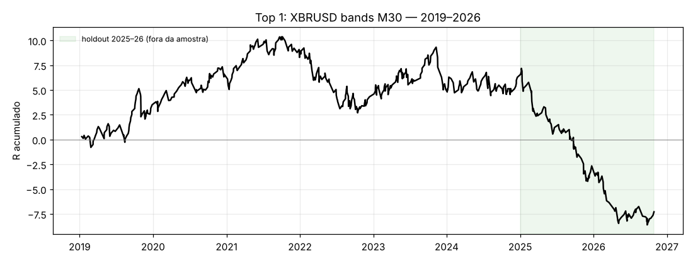
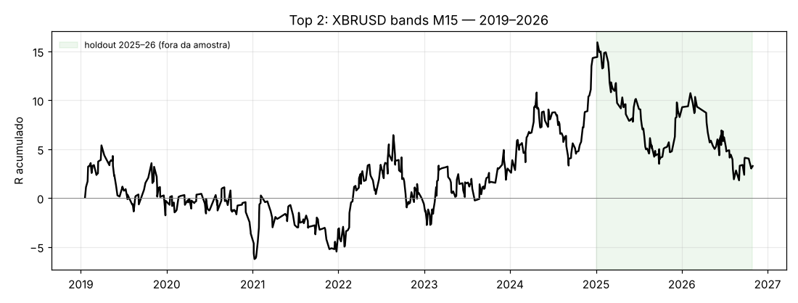
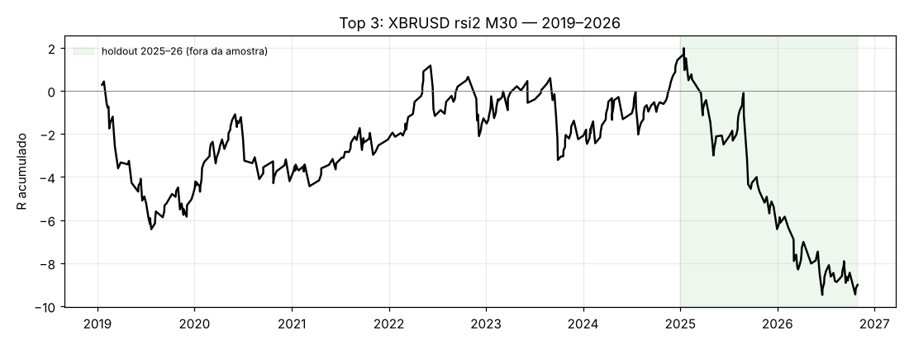

# Relatório XBRUSD (Brent) — top 3 estratégias

**Pedido:** criar estratégias de scalping para o XBRUSD e otimizá-las em loop até cumprir, no mínimo, **WR ≥ 57%, PF ≥ 1,01, DD máx. ≤ 20% e ≥ 100 trades**; entregar o top 3 a correr em MT5.

## Resumo

| # | EA (MT5) | Estratégia | TF | Sessão | Holdout 2025-01 → 2026-10: trades | WR | PF | DD máx | t | Alvos |
|---|---|---|---|---|---|---|---|---|---|---|
| 1 | [`ScalperXBR_T1.mq5`](../mql5/ScalperXBR_T1.mq5) | Bands (fade ao desvio da média móvel) | M30 | sobreposição 13–17 UTC | 113 ✔ | 48,7% ✘ | 0,53 ✘ | 13,8% ✔ | -2,81 | 2/4 |
| 2 | [`ScalperXBR_T2.mq5`](../mql5/ScalperXBR_T2.mq5) | Bands (fade ao desvio da média móvel) | M15 | sobreposição 13–17 UTC | 128 ✔ | 53,1% ✘ | 0,72 ✘ | 13,4% ✔ | -1,43 | 2/4 |
| 3 | [`ScalperXBR_T3.mq5`](../mql5/ScalperXBR_T3.mq5) | RSI-2 a favor da tendência | M30 | 07–18 UTC | 93 ✘ | 60,2% ✔ | 0,57 ✘ | 10,2% ✔ | -2,17 | 2/4 |

No mesmo período de ajuste (2019–2024, dentro da amostra):

| # | trades | WR | PF | DD máx | anos positivos |
|---|---|---|---|---|---|
| 1 | 411 | 65,5% | 1,09 | 6,9% | 5/6 |
| 2 | 447 | 58,8% | 1,12 | 11,1% | 4/6 |
| 3 | 273 | 71,1% | 1,03 | 6,7% | 4/6 |

**Leitura honesta:**

- **Nenhuma das três cumpre os alvos fora da amostra.** Em 2019–2024 as três cumpriam WR ≥ 57% e PF ≥ 1,01 com DD baixo, e o #1 foi positivo em 5 dos 6 anos.
- **Em 2025–2026 as três perderam.** Nesse período o Brent caiu de ~US$75 para ~US$59 em 2025 e depois subiu ~90%, até ~US$120, em 2026, com volatilidade anual de 54%. Mesmo **sem custos** o PF do holdout fica em 0,82 / 1,00 / 0,75. Não é um problema de custos: a vantagem das três desapareceu nesse regime.
- **Reotimizar a cada 4 meses (walk-forward) também não salva.** Cinco das seis variantes perdem fora da amostra (PF 0,51–0,74). A sexta (Bands M15, portões relaxados) é positiva (PF 1,15, WR 57,8%), mas com só 45 trades e t = 0,41.
- **Conclusão:** com estes dados e custos realistas, não encontrei um scalper de Brent que cumpra os quatro alvos de forma robusta. Os três EAs entregues são o melhor que o loop produziu com dados até 2024. Servem como ponto de partida para reotimizar no MT5 com os custos e ticks reais da tua corretora, **não como sistemas prontos para conta real**.

## Top 1 — Bands (fade ao desvio da média móvel), M30

**Entrada:** fecho a ≥ 2,0 desvios-padrão da média de 48 barras, RSI(7) ≤ 20 (compra) / ≥ 80 (venda), confirmação modo 2. **Saída:** stop = max(3,0 ATR, 0,15% do preço), alvo 0,3R, break-even a +0,5R, fecho parcial de 50% a +0,40R, máximo 180 min, 4 trades/dia, pausa 5 min, risco 1,00% por trade.

| ano | 2019 | 2020 | 2021 | 2022 | 2023 | 2024 | 2025 | 2026 |
|---|---|---|---|---|---|---|---|---|
| trades | 65 | 58 | 63 | 75 | 78 | 72 | 69 | 48 |
| WR | 70,8% | 65,5% | 65,1% | 56,0% | 69,2% | 66,7% | 47,8% | 52,1% |
| PF | 1,34 | 1,40 | 1,20 | 0,75 | 1,05 | 1,09 | 0,52 | 0,61 |
| R | 3,5 | 3,1 | 2,0 | -4,3 | 0,8 | 1,2 | -8,9 | -4,6 |

2025 e 2026 são o holdout, fora da amostra. Sensibilidade a custos no holdout (PF / WR):

| custo × | 0,0 | 0,5 | 1,0 | 1,5 | 2,0 |
|---|---|---|---|---|---|
| PF | 0,82 | 0,74 | 0,53 | 0,49 | 0,41 |
| WR | 56,1% | 55,6% | 48,7% | 47,4% | 45,1% |

## Top 2 — Bands (fade ao desvio da média móvel), M15

**Entrada:** fecho a ≥ 2,0 desvios-padrão da média de 96 barras, RSI(7) ≤ 20 (compra) / ≥ 80 (venda), Efficiency Ratio ≤ 0,50, confirmação modo 2. **Saída:** stop = max(3,0 ATR, 0,15% do preço), alvo 1,5R, break-even a +0,5R, máximo 240 min, 4 trades/dia, pausa 5 min, risco 1,00% por trade.

| ano | 2019 | 2020 | 2021 | 2022 | 2023 | 2024 | 2025 | 2026 |
|---|---|---|---|---|---|---|---|---|
| trades | 68 | 66 | 63 | 87 | 81 | 82 | 80 | 50 |
| WR | 61,8% | 60,6% | 57,1% | 50,6% | 58,0% | 65,9% | 55,0% | 52,0% |
| PF | 0,99 | 0,81 | 1,03 | 1,09 | 1,19 | 1,61 | 0,77 | 0,74 |
| R | -0,3 | -3,4 | 0,4 | 2,6 | 3,6 | 11,4 | -6,1 | -5,0 |

2025 e 2026 são o holdout, fora da amostra. Sensibilidade a custos no holdout (PF / WR):

| custo × | 0,0 | 0,5 | 1,0 | 1,5 | 2,0 |
|---|---|---|---|---|---|
| PF | 1,00 | 0,85 | 0,72 | 0,64 | 0,57 |
| WR | 57,8% | 54,7% | 53,1% | 50,0% | 46,1% |

## Top 3 — RSI-2 a favor da tendência, M30

**Entrada:** RSI(2) ≤ 5 com fecho acima da EMA(50) → compra; RSI ≥ 95 abaixo da EMA → venda. **Saída:** stop = max(3,0 ATR, 0,15% do preço), alvo 0,3R, fecho parcial de 50% a +0,25R, máximo 180 min, 4 trades/dia, pausa 20 min, risco 1,00% por trade.

| ano | 2019 | 2020 | 2021 | 2022 | 2023 | 2024 | 2025 | 2026 |
|---|---|---|---|---|---|---|---|---|
| trades | 47 | 47 | 38 | 41 | 44 | 56 | 51 | 42 |
| WR | 59,6% | 72,3% | 68,4% | 73,2% | 72,7% | 78,6% | 56,9% | 64,3% |
| PF | 0,58 | 1,09 | 1,38 | 1,15 | 0,89 | 1,54 | 0,48 | 0,72 |
| R | -4,8 | 0,7 | 1,8 | 1,0 | -1,0 | 3,7 | -7,8 | -2,6 |

2025 e 2026 são o holdout, fora da amostra. Sensibilidade a custos no holdout (PF / WR):

| custo × | 0,0 | 0,5 | 1,0 | 1,5 | 2,0 |
|---|---|---|---|---|---|
| PF | 0,75 | 0,63 | 0,57 | 0,51 | 0,46 |
| WR | 67,7% | 63,4% | 60,2% | 60,2% | 58,1% |

## Volta final: walk-forward com reotimização a cada 4 meses

| estratégia | período | trades | WR | PF | DD máx (0,5%/trade) | t | alvos |
|---|---|---|---|---|---|---|---|
| Bands M30 tight — portões WR≥57% PF≥1,02 | 2021-01 → 2026-10 | 77 | 41,6% | 0,55 | 5,9% | -2,15 | 1/4 |
| Bands M30 tight — portões WR≥57% PF≥1,02 | só 2025-01 → 2026-10 | 41 | 34,1% | 0,31 | 3,3% | -2,92 | 1/4 |
| Bands M15 base — portões WR≥57% PF≥1,02 | 2021-01 → 2026-10 | 0 — nenhum reajuste passou os portões (EA parado) | | | | | |
| RSI-2 M30 tight — portões WR≥57% PF≥1,02 | 2021-01 → 2026-10 | 191 | 56,0% | 0,72 | 7,3% | -1,82 | 2/4 |
| RSI-2 M30 tight — portões WR≥57% PF≥1,02 | só 2025-01 → 2026-10 | 0 — nenhum reajuste passou os portões (EA parado) | | | | | |
| Bands M30 tight — portões WR≥55% PF≥1,0 | 2021-01 → 2026-10 | 99 | 39,4% | 0,51 | 7,0% | -2,67 | 1/4 |
| Bands M30 tight — portões WR≥55% PF≥1,0 | só 2025-01 → 2026-10 | 41 | 34,1% | 0,31 | 3,3% | -2,92 | 1/4 |
| Bands M15 base — portões WR≥55% PF≥1,0 | 2021-01 → 2026-10 | 45 | 57,8% | 1,15 | 1,9% | 0,41 | 3/4 |
| Bands M15 base — portões WR≥55% PF≥1,0 | só 2025-01 → 2026-10 | 0 — nenhum reajuste passou os portões (EA parado) | | | | | |
| RSI-2 M30 tight — portões WR≥55% PF≥1,0 | 2021-01 → 2026-10 | 202 | 57,4% | 0,74 | 7,3% | -1,78 | 3/4 |
| RSI-2 M30 tight — portões WR≥55% PF≥1,0 | só 2025-01 → 2026-10 | 0 — nenhum reajuste passou os portões (EA parado) | | | | | |

Em cada janela de 120 dias o otimizador reescolhe os parâmetros com os 2 anos anteriores. Se nenhuma configuração passa os portões, o EA não negoceia nessa janela. O DD está calculado a 0,5% de risco por trade.

## O loop de otimização

| volta | protocolo | resultado |
|---|---|---|
| 1 | 7 famílias × M1/M5/M15/M30, ajuste 2019–22 com portões WR ≥ 57%, PF ≥ 1,05, DD ≤ 20%, validação 2023–24 | 1 configuração passou o ajuste (M30 breakout) e falhou a validação (PF 0,64). M1 é inviável (custo 0,9 ATR) |
| 2 | variante *tight* (alvos 0,3–0,8R, break-even, parcial), portões WR ≥ 55%, PF ≥ 1,0 | 3 passaram o ajuste (WR 62–72%) e todas caíram na validação (PF 0,50–0,69): mudança de regime |
| — | estatística direta | reversão após 2σ: 1–5 bp; ORB das 07/13 UTC reverte ~4–5 bp → nova família **ORB fade**; nenhum efeito sessão/dia × hora acima do custo (~7 bp) |
| 3 | protocolo v2: ajuste em 2019–2024 inteiro, portões WR ≥ 57%, PF ≥ 1,02, DD ≤ 20%; ordenação por consistência anual | 42 células, 1 com candidatos, 0 candidatos a cumprir os alvos no ajuste |
| 4 | duas fases: entradas com vantagem bruta e depois só saídas; sem portão de DD | 7 células, 0 com candidatos, 0 candidatos a cumprir os alvos no ajuste |
| 5 | portões WR ≥ 55%, PF ≥ 1,0, 500 iterações, M15/M30 | 28 células, 0 com candidatos, 0 candidatos a cumprir os alvos no ajuste |
| 6 | pontuação suave orientada aos alvos + subida coordenada a partir das 3 melhores sementes por célula | 42 células, 42 com candidatos, 8 candidatos a cumprir os alvos no ajuste |
| 7 | aprofundamento das famílias que funcionaram (bands, RSI-2, fade) em M10/M15/M20/M30, 4 sementes, piso de 60 trades/ano para chegar aos 100 trades no holdout | 24 células, 24 com candidatos, 8 candidatos a cumprir os alvos no ajuste |

## Como correr no MT5

1. Copiar `mql5/ScalperXBR_T1.mq5`, `ScalperXBR_T2.mq5` e `ScalperXBR_T3.mq5` para `MQL5/Experts/` e compilar no MetaEditor.
2. Anexar ao gráfico **XBRUSD** (qualquer timeframe; o EA usa o timeframe de sinal definido em `InpSignalTF`). Se a corretora usar outro nome (`UKOIL`, `BRENT`, `XBRUSD.r`), pôr `InpCheckSymbol=false`.
3. **Strategy Tester:** usar "Every tick based on real ticks" e `InpGmtOffsetHours` = offset do servidor (normalmente 2 no inverno e 3 no verão), porque todas as horas são UTC.
4. **Otimização no MT5:** carregar o `.set` correspondente em `mql5/sets/` (as linhas `Y` são os parâmetros a otimizar) e usar o *genetic algorithm* com *Forward 1/3*.
5. **Risco por trade:** definido em `InpRiskPct`. Foi escolhido em 2019–2024 para o DD ficar ≤ 12% no ajuste (folga para os 20%). O DD escala com este valor; a WR e o PF não.
6. Os três EAs usam magic numbers diferentes e podem correr em simultâneo no mesmo gráfico ou em gráficos separados.

## Pressupostos e limites

- **Dados:** OANDA BCO/USD M1 reais, jan/2019 → out/2026 (preços médios). Os custos modelados são spread de 5 bp (US$0,04 a US$80), que alarga ×2 na sessão asiática, ×5 no rollover e com a volatilidade, mais slippage de 0,6 bp na entrada e 1,5 bp no stop. São cerca de 7 bp por trade, do lado conservador para uma conta ECN.
- **Este ambiente não tem MetaTrader 5.** A otimização foi feita no backtester Python do repositório, que replica a lógica do EA. Não consegui compilar os EAs nem corrê-los no Strategy Tester aqui. Confirma-os no MT5 com os ticks da tua corretora antes de os usar.
- **Seleção:** foram geradas e avaliadas milhares de configurações em várias voltas, e o top 3 foi escolhido só com 2019–2024. O holdout 2025–26 foi olhado **uma única vez**, já com o top 3 escolhido. Mesmo assim, com edges deste tamanho, um t-stat abaixo de 2 significa que o resultado pode ser sorte.
