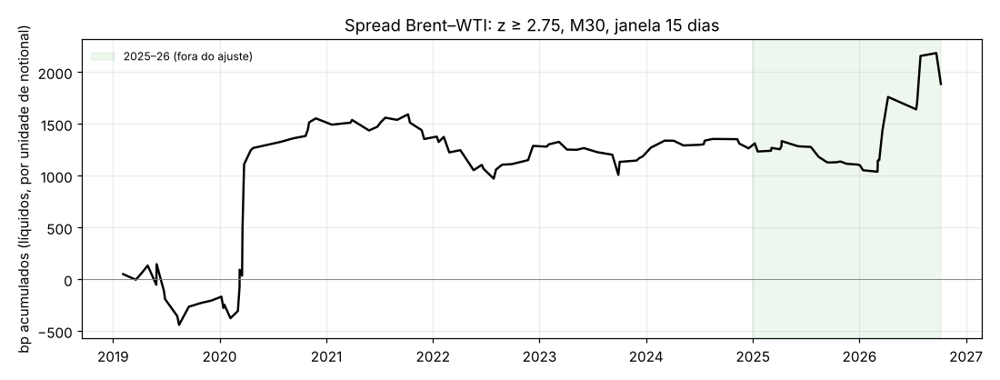

# XBRUSD — estratégias de profissionais e da literatura (fora das "tradicionais")

**Pedido:** sair das estratégias técnicas tradicionais e pesquisar o que usam os
principais scalpers e campeões de trading no petróleo. Testar essas ideias no
Brent e entregar o que funcionar a correr em MT5.

## 1. O que a pesquisa encontrou

| Fonte | O que usam no crude |
|---|---|
| **Andrea Unger** (único campeão do mundo 4×, World Cup Trading Championship) | Sistemas intradiários no crude: um trade por semana à volta do **relatório EIA** (quarta, 10:30 ET); **breakout intradiário** em 5 min com filtro diário; trend-following intradiário em 60 min; e **"bias" horário** (deriva média por janela horária). As regras completas não são públicas. |
| **Literatura académica** — Wen, Indriawan, Lien & Xu (*Energy Journal* 2023); Wen, Gong, Ma & Xu (2021) | **Momentum intradiário**: o retorno da 1.ª meia hora (com o overnight) prevê o da última. Em dias EIA, a meia hora das 10:30 ET substitui a primeira. A reação ao EIA depende da **surpresa** face ao consenso (Ye & Karali). |
| **Larry Williams** | **Volatility breakout**: abertura ± k × amplitude do dia anterior. O próprio admite que funciona pior em anos recentes. |
| Kevin Davey (campeão World Cup) | Livro *Building Winning Algorithmic Trading Systems*: breakouts e canais de Keltner, sem regras específicas para o crude publicadas. |
| Corretoras / mesas (StoneX, Daniels) | Abertura do pit às 9:00 ET, **números redondos** ($X,00 / $X,50), VWAP ancorada na abertura com bandas de desvio, order flow / delta acumulado. |
| **Arbitragem estatística** — Ogrodniczuk (z-score horário); arXiv 2309.00875 (pares Brent/WTI/Shanghai, cointegração) | **Spread Brent–WTI** é cointegrado e reverte à média; só desvios grandes cobrem os custos das duas pernas. |

Não consegui abrir as páginas da Unger Academy: o domínio `ungeracademy.com` não
está nos domínios de rede permitidos desta sessão. A descrição acima vem dos
resumos da pesquisa.

## 2. Teste direto nos dados (Brent OANDA M1 2019–2026, líquido de custos)

Antes de otimizar o que quer que fosse, medi a vantagem bruta de cada ideia
(`scripts/xbr_research.py`, `reports/xbr_research.json`). Custos assumidos por
operação: 7 bp; 10 bp à volta do EIA; 14 bp no spread, por ter duas pernas.

| Ideia | Fonte | trades | bruto (bp) | líquido (bp) | WR | PF | t | PF 2025–26 |
|---|---|---|---|---|---|---|---|---|
| EIA (quarta 10:30 ET): direção dos primeiros 15 min, até ao settlement | Unger Academy; Wen et al. 2023 | 369 | 11,41 | 1,41 | 48,2% | 1,03 | 0,19 | 0,94 |
| EIA: fade dos primeiros 15 min, até ao settlement | variante contrária | 369 | -11,41 | -21,41 | 42,3% | 0,64 | -2,93 | 0,65 |
| EIA: direção dos primeiros 5 min, 1 hora | Unger Academy | 358 | 4,83 | -5,17 | 45,5% | 0,83 | -1,32 | 0,67 |
| Momentum intradiário: 1.ª meia hora (NY, com overnight) → última meia hora antes do settlement | Gao-Han-Li-Zhou; Wen et al. 2021 | 1974 | -1,64 | -8,64 | 39,4% | 0,59 | -7,42 | 0,54 |
| Idem em dias EIA (10:30–11:00 ET → última meia hora) | Wen et al. 2023 | 402 | -2,50 | -9,50 | 40,0% | 0,53 | -4,50 | 0,23 |
| Idem no relógio de Londres (settlement ICE 19:30) | adaptação ao Brent | 1967 | -1,59 | -8,59 | 39,2% | 0,56 | -8,07 | 0,44 |
| Volatility breakout de Larry Williams (abertura ± 0,5 × amplitude de ontem) | Larry Williams | 1556 | 5,82 | -1,18 | 49,9% | 0,98 | -0,23 | 0,81 |
| Idem, k = 0,7 | Larry Williams | 1141 | 5,45 | -1,55 | 49,8% | 0,97 | -0,27 | 0,73 |
| Spread Brent–WTI, z horário ≥ 2,5, até 72 h | Ogrodniczuk; arXiv 2309.00875 | 131 | 27,82 | 13,82 | 54,2% | 1,45 | 1,28 | 1,20 |
| Spread Brent–WTI, z horário ≥ 3,0, até 72 h | idem | 73 | 49,28 | 35,28 | 58,9% | 2,28 | 2,04 | 2,35 |

**Leitura:**
- **EIA:** ligeiro momentum bruto (+8 a +11 bp até ao settlement), que não chega para cobrir o spread alargado do evento. O fade é claramente negativo.
- **Momentum 1.ª → última meia hora:** no Brent (2019–2026) inverte-se em vez de continuar, e o PF líquido fica em 0,56–0,60. O efeito publicado (em dados de USO de 2006–2018) não se mantém neste instrumento e período.
- **Volatility breakout de Williams:** neutro antes de custos e ligeiramente negativo depois (PF 0,97–0,98).
- **Spread Brent–WTI:** é a única ideia com vantagem líquida positiva, e cresce com o limiar (z ≥ 3: +35 bp por trade, PF 2,28, t 2,04).
- **Já testado antes e também nulo:** order flow e VWAP de mesa precisam de dados de livro de ordens, que não existem para CFDs. Números redondos, sessões e "bias" horário tinham ficado abaixo do custo na ronda anterior.

## 3. Estratégia desenvolvida: spread Brent–WTI (`mql5/ScalperXBR_Spread.mq5`)

**Regras:**
- **Sinal:** s = ln(Brent) − ln(WTI) em barras M30 fechadas; z = z-score móvel de 15 dias.
- **Entrada:** quando |z| ≥ 2,75, aposta na reversão com o **mesmo notional em USD nas duas pernas**. Se z > 0, vende Brent e compra WTI; se z < 0, o contrário.
- **Saída:** quando |z| ≤ 1,00, ou ao fim de 72 h.
- **Custos modelados:** 7 bp por perna e swap de 1,5 bp por perna por noite (×3 à quarta).

**Seleção:** grelha de 576 combinações (timeframe, janela, limiar,
saída, stop de spread, tempo máximo), escolhida **só com 2019–2024**. Os
filtros foram ≥ 80 trades, WR ≥ 57% e PF ≥ 1,2, e só 4
combinações os passaram. A alavancagem (notional por perna = 1,50× o
capital) foi escolhida no ajuste para manter o DD ≤ 10%.

| | trades | WR | PF | DD máx | t | alvos (≥100 tr, WR ≥ 57%, PF ≥ 1,01, DD ≤ 20%) |
|---|---|---|---|---|---|---|
| Ajuste 2019–2024 | 83 | 61,5% | 1,50 | 8,97% | 1,16 | ✘ ✔ ✔ ✔ |
| Fora do ajuste 2025-01 → 2026-10 | 28 | 50,0% | 1,76 | 4,48% | 0,84 | ✘ ✘ ✔ ✔ |
| **Total 2019–2026** | **111** | **58,6%** | **1,56** | **8,97%** | 1,44 | **✔ ✔ ✔ ✔** |

| ano | trades | WR | PF | bp/trade | retorno |
|---|---|---|---|---|---|
| 2019 | 13 | 53,8% | 0,75 | -15,81 | -3,29% |
| 2020 | 18 | 83,3% | 6,90 | 97,77 | 29,17% |
| 2021 | 12 | 50,0% | 0,53 | -16,61 | -2,99% |
| 2022 | 15 | 60,0% | 0,87 | -4,43 | -1,09% |
| 2023 | 13 | 53,8% | 0,70 | -7,81 | -1,58% |
| 2024 | 12 | 58,3% | 1,57 | 6,51 | 1,16% |
| 2025 | 17 | 41,2% | 0,51 | -9,67 | -2,47% |
| 2026 | 11 | 63,6% | 2,63 | 71,38 | 11,86% |

Sensibilidade a custos (2019–2026), com o custo a 0× / 0,5× / 1× / 1,5× / 2×:
o PF fica em 2,23 | 1,87 | 1,56 | 1,30 | 1,08 e a WR em 66,7% | 63,1% | 58,6% | 53,1% | 51,3%.

**Leitura honesta:**
- **Cumpre os quatro mínimos no backtest completo 2019–2026:** 111 trades, WR 58,6%, PF 1,56, DD 8,97%. É a primeira estratégia de Brent nesta sessão que o consegue.
- **O lucro vem de deslocamentos raros.** Março de 2020 (COVID) e 2026 (pico do petróleo) dão quase tudo. Sem 2020 e 2026, o PF é **0,75**: nos anos normais perde um pouco, à espera do próximo choque. É um "colhedor de crises", não uma máquina regular.
- **Só 4 das 576 combinações passam o filtro no ajuste.** A mediana dos vizinhos tem PF 1,25 e o pior vizinho 0,69. É frágil em relação aos parâmetros, e t = 1,44 não é significativo.
- **2025–26 não é totalmente virgem para esta ideia.** O primeiro teste de pesquisa (secção 2) já mostrava o PF de 2025–26 para 6 pontos da grelha antes da seleção.
- **Não é scalping:** as posições duram em média ~85 h. É arbitragem de spread entre dois petróleos, com duas pernas abertas ao mesmo tempo.

## 4. No MT5

1. Copiar `mql5/ScalperXBR_Spread.mq5` para `MQL5/Experts/` e compilar. Anexar a qualquer gráfico.
2. Os dois símbolos têm de existir na corretora (`InpBrent`, `InpWti`, por exemplo `UKOIL`/`USOIL`) e estar no Market Watch.
3. O EA abre sempre as duas pernas juntas. Se uma falhar, fecha a outra (nunca fica uma perna "nua").
4. Strategy Tester: "Every tick based on real ticks"; o teste é multi-símbolo. Os intervalos de otimização estão em `mql5/sets/ScalperXBR_Spread.set`.
5. **Swap:** posições de vários dias pagam financiamento nas duas pernas. Confirma os swaps de XBRUSD/XTIUSD da tua corretora, porque foram estimados aqui em 1,5 bp por perna por noite.
6. **Não foi compilado nem corrido no MT5** (não há MetaTrader neste ambiente). A lógica replica `scripts/xbr_spread.py`.

## Fontes
- [Unger Academy — Trading Crude Oil: 2 strategies](https://ungeracademy.com/blog/trading-crude-oil-usd37-000-with-these-2-game-changing-strategies) · [Crude Oil – Reversal and Bias](https://ungeracademy.com/blog/crude-oil-best-strategies-reversal-and-bias-with-results) · [Strategy of the month: trend following on crude](https://ungeracademy.com/blog/strategy-of-the-month-the-winner-is-a-trend-following-on-crude-oil-with-an-amazing-equity-curve) · [How to win the World Cup Trading Championships](https://ungeracademy.com/?p=6821)
- [Wen, Indriawan, Lien & Xu — Intraday Return Predictability in the Crude Oil Market: the Role of EIA Inventory Announcements (Energy Journal 2023)](https://econpapers.repec.org/RePEc:sae:enejou:v:44:y:2023:i:5:p:149-172) · [resumo IAEE](https://www.iaee.org/ej/ejexec/ej44-5-Xu-exsum.pdf)
- [Wen, Gong, Ma & Xu — intraday momentum in oil (Economic Modelling 2021)](https://econpapers.repec.org/RePEc:eee:ecmode:v:95:y:2021:i:c:p:374-384)
- [Ye & Karali — inventory surprises and crude futures (AAEA)](https://ageconsearch.umn.edu/record/205595/files/AAEA_Ye_Karali-2015.pdf) · [Geman & Li — intraday response to inventory shocks (J. Energy Markets)](https://www.risk.net/journal-of-energy-markets/5728636/an-analysis-of-intraday-market-response-to-crude-oil-inventory-shocks)
- [Ogrodniczuk — Hourly Brent vs WTI: from signal to strategy](https://www.ethanogrodniczuk.com/articles/blog-post-title-two-tjlh3-b2x5b-bpmdg) · [arXiv 2309.00875 — pairs trading Brent/WTI/Shanghai](https://arxiv.org/pdf/2309.00875v3) · [StockSharp — WTI/Brent spread](https://doc.stocksharp.com/en/api-examples/0410_WTIBrent_Spread)
- [StoneX — scalping strategies for WTI](https://futures.stonex.com/blog/scalping-strategies-for-wti-crude-oil) · [Daniels Trading — 3 scalping strategies for WTI](https://www.danielstrading.com/2020/09/03/3-scalping-strategies-for-wti-crude-oil)
- [Larry Williams volatility breakout (WH SelfInvest)](https://www.whselfinvest.de/en-de/trading-platform/free-trading-strategies/tradingsystem/56-volatility-break-out-larry-williams-free) · [LuxAlgo — volatility breakout](https://www.luxalgo.com/library/concept/volatility-breakout/)
- [Kevin Davey — Building Winning Algorithmic Trading Systems](https://www.financialwisdomtv.com/post/building-winning-algorithmic-trading-systems-kevin-davey-s-complete-framework-for-trading-success) · [Benzinga — false breakout on crude futures](https://www.benzinga.com/trading-ideas/technicals/25/05/45202553/is-the-false-breakout-strategy-worth-using-on-crude-oil-futures)
