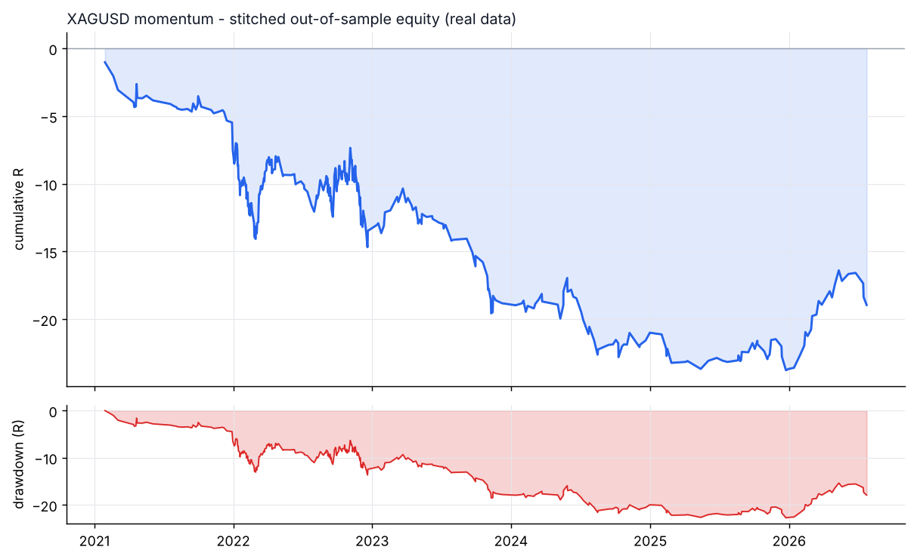
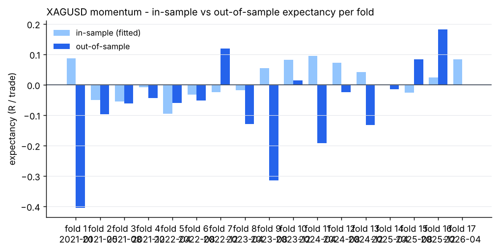
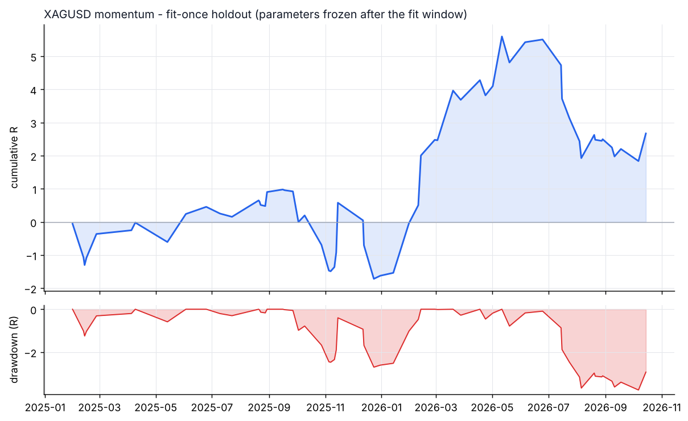

# XAGUSD - momentum - walk-forward result

- data: **real** - data/raw/XAGUSD/*.parquet
- span: 2019-01-02 to 2026-10-30
- folds: 17 x (train 730d / test 120d), contiguous out-of-sample coverage 2040 days
- configurations evaluated: 6,800

## Targets, measured on out-of-sample data only

| Target | Required | Achieved | Result |
|---|---|---|---|
| Trades >= 100 | 100 | 336 | **PASS** |
| Profit factor >= 1.20 | 1.20 | 0.79 | FAIL |
| Win rate >= 50% | 50.0 | 48.5 | FAIL |

## Metrics

| Metric | Walk-forward OOS | Fit-once holdout | Full sample (deployed params) |
|---|---|---|---|
| Trades | 336 | 61 | 272 |
| Win rate % | 48.5 | 47.5 | 51.1 |
| Profit factor | 0.79 | 1.20 | 0.98 |
| Expectancy (R) | -0.056 | 0.044 | -0.005 |
| Avg win (R) | 0.45 | 0.56 | 0.40 |
| Avg loss (R) | -0.53 | -0.42 | -0.43 |
| Payoff | 0.84 | 1.32 | 0.94 |
| Total R | -18.9 | 2.7 | -1.2 |
| Return % | -6.0 | 3.9 | 4.8 |
| Max DD % | 10.9 | 2.5 | 5.0 |
| Max DD (R) | 22.7 | 3.8 | 12.4 |
| Sharpe | -1.43 | 0.70 | 0.29 |
| Sortino | -2.39 | 0.56 | 0.21 |
| CAGR % | -7.2 | 1.7 | 0.5 |
| Calmar | -0.66 | 0.67 | 0.10 |
| Trades/day | 1.03 | 0.11 | 0.11 |
| Avg hold (min) | 287 | 202 | 208 |
| Max consec. losses | 7 | 5 | 6 |
| t-stat of mean R | -1.73 | 0.53 | -0.14 |
| Friction / gross % | 14.9 | 14.1 | 15.4 |

- walk-forward efficiency (OOS / IS expectancy): **-4.19**
- bootstrap p-value for mean R > 0 (OOS): **0.9592**
- neighbourhood stability: 19 neighbours, median score 0.55, 89% positive

## Cost sensitivity (fit-once holdout, parameters frozen)

| cost x | trades | win rate | PF | expectancy R | t |
|---|---|---|---|---|---|
| 0.00 | 61 | 60.7% | 1.57 | +0.110 | 1.33 |
| 0.25 | 61 | 60.7% | 1.47 | +0.093 | 1.13 |
| 0.50 | 61 | 57.4% | 1.37 | +0.077 | 0.93 |
| 0.75 | 61 | 49.2% | 1.28 | +0.060 | 0.73 |
| 1.00 | 61 | 47.5% | 1.20 | +0.044 | 0.53 |
| 1.25 | 61 | 49.2% | 1.20 | +0.048 | 0.55 |
| 1.50 | 61 | 49.2% | 1.13 | +0.032 | 0.37 |

## Per-fold

```
walk-forward folds:
  1: train 2019-01-02..2021-01-01 IS   60tr +0.087R -> test 2021-01-01..2021-05-01 OOS    9tr -0.406R PF 0.32 WR 22.2%
  2: train 2019-05-02..2021-05-01 IS   70tr -0.051R -> test 2021-05-01..2021-08-29 OOS    9tr -0.098R PF 0.18 WR 11.1%
  3: train 2019-08-30..2021-08-29 IS   68tr -0.056R -> test 2021-08-29..2021-12-27 OOS   13tr -0.061R PF 0.70 WR 46.2%
  4: train 2019-12-28..2021-12-27 IS  377tr -0.009R -> test 2021-12-27..2022-04-26 OOS   69tr -0.044R PF 0.82 WR 49.3%
  5: train 2020-04-26..2022-04-26 IS  101tr -0.095R -> test 2022-04-26..2022-08-24 OOS   22tr -0.061R PF 0.71 WR 45.5%
  6: train 2020-08-24..2022-08-24 IS  409tr -0.032R -> test 2022-08-24..2022-12-22 OOS   72tr -0.052R PF 0.84 WR 50.0%
  7: train 2020-12-22..2022-12-22 IS   66tr -0.024R -> test 2022-12-22..2023-04-21 OOS   13tr +0.118R PF 1.51 WR 61.5%
  8: train 2021-04-21..2023-04-21 IS   71tr -0.018R -> test 2023-04-21..2023-08-19 OOS   17tr -0.129R PF 0.43 WR 41.2%
  9: train 2021-08-19..2023-08-19 IS   80tr +0.054R -> test 2023-08-19..2023-12-17 OOS   15tr -0.315R PF 0.32 WR 33.3%
  10: train 2021-12-17..2023-12-17 IS   66tr +0.082R -> test 2023-12-17..2024-04-15 OOS   11tr +0.014R PF 1.09 WR 63.6%
  11: train 2022-04-16..2024-04-15 IS   80tr +0.095R -> test 2024-04-15..2024-08-13 OOS   15tr -0.193R PF 0.56 WR 40.0%
  12: train 2022-08-14..2024-08-13 IS   69tr +0.072R -> test 2024-08-13..2024-12-11 OOS   13tr -0.024R PF 0.91 WR 61.5%
  13: train 2022-12-12..2024-12-11 IS   74tr +0.042R -> test 2024-12-11..2025-04-10 OOS    9tr -0.132R PF 0.57 WR 55.6%
  14: train 2023-04-11..2025-04-10 IS   73tr -0.001R -> test 2025-04-10..2025-08-08 OOS    5tr -0.014R PF 0.92 WR 40.0%
  15: train 2023-08-09..2025-08-08 IS   83tr -0.025R -> test 2025-08-08..2025-12-06 OOS   20tr +0.084R PF 1.75 WR 60.0%
  16: train 2023-12-07..2025-12-06 IS   84tr +0.025R -> test 2025-12-06..2026-04-05 OOS   14tr +0.181R PF 1.88 WR 64.3%
  17: train 2024-04-05..2026-04-05 IS   77tr +0.083R -> test 2026-04-05..2026-08-03 OOS   10tr -0.002R PF 1.00 WR 50.0%
stitched OOS: trades   336 | WR  48.5% | PF  0.79 | exp -0.056R | payoff 0.84 | totR   -18.9 | ret    -6.0% | DD  10.9% | Sharpe -1.43 | t -1.73
walk-forward efficiency: -4.19
```

## Deployed parameters

```json
{
  "strategy": {
    "mode": "momentum",
    "tf_minutes": 5,
    "session": "ny",
    "atr_period": 14,
    "atr_rank_lookback": 288,
    "atr_rank_min": 0.1,
    "atr_rank_max": 0.99,
    "sl_atr": 4.0,
    "tp_r": 1.0,
    "min_sl_points": 0.0,
    "min_sl_bp": 192,
    "allow_long": true,
    "allow_short": true,
    "er_period": 24,
    "er_min": 0.6,
    "er_max": 1.0,
    "vwap_anchor_hour": 0,
    "band_k": 2.0,
    "rsi_period": 7,
    "rsi_lo": 28.0,
    "rsi_hi": 72.0,
    "adx_period": 14,
    "adx_max": 30.0,
    "confirm_mode": 2,
    "min_dev_atr": 0.0,
    "bb_period": 48,
    "don_period": 24,
    "ema_fast": 12,
    "ema_slow": 48,
    "adx_min": 20.0,
    "expansion_mult": 1.15,
    "atr_avg_period": 48,
    "pb_slope_period": 30,
    "pb_rsi_lo": 40.0,
    "pb_rsi_hi": 60.0,
    "pb_depth_atr": 0.5,
    "pb_lookback": 6,
    "mom_period": 12,
    "mom_min_atr": 2.5,
    "mom_confirm": 1
  },
  "execution": {
    "point": 0.001,
    "value_per_point_per_lot": 5.0,
    "min_lot": 0.01,
    "lot_step": 0.01,
    "max_lot": 50.0,
    "commission_per_lot_rt": 0.0,
    "slippage_points_entry": 3.0,
    "slippage_points_stop": 8.0,
    "swap_long_points": -15.0,
    "swap_short_points": 0.0,
    "initial_equity": 10000.0,
    "risk_pct": 0.005,
    "max_spread_points": 1000000000000.0,
    "be_trigger_r": 0.0,
    "be_offset_r": 0.1,
    "partial_r": 0.6,
    "partial_frac": 0.5,
    "trail_start_r": 1.0,
    "trail_dist_r": 1.0,
    "max_bars": 240,
    "cooldown_bars": 240,
    "max_trades_per_day": 1,
    "daily_loss_limit_r": 1000000000.0,
    "force_exit_hour": 20,
    "force_exit_min": 45,
    "compound": true
  }
}
```

## Out-of-sample breakdown

**by hour**

|   hour |   trades |   win_rate |   total_r |   exp_r |
|-------:|---------:|-----------:|----------:|--------:|
|      7 |       56 |       48.2 |      -3.4 |  -0.06  |
|      8 |       39 |       43.6 |      -6.2 |  -0.159 |
|      9 |       22 |       50   |       1.2 |   0.055 |
|     10 |       17 |       47.1 |      -2.5 |  -0.149 |
|     11 |       15 |       80   |       4.9 |   0.327 |
|     12 |       33 |       42.4 |      -7.2 |  -0.219 |
|     13 |       45 |       51.1 |      -0.4 |  -0.008 |
|     14 |       33 |       33.3 |      -3.8 |  -0.114 |
|     15 |       29 |       44.8 |      -0.3 |  -0.01  |
|     16 |       24 |       62.5 |      -1.1 |  -0.047 |
|     17 |       21 |       47.6 |      -1.3 |  -0.064 |
|     18 |        2 |      100   |       1.2 |   0.587 |

**by direction**

| direction   |   trades |   win_rate |   total_r |   exp_r |
|:------------|---------:|-----------:|----------:|--------:|
| long        |      181 |       50.3 |        -6 |  -0.033 |
| short       |      155 |       46.5 |       -13 |  -0.084 |

**by exit**

| exit_reason   |   trades |   win_rate |   total_r |   exp_r |
|:--------------|---------:|-----------:|----------:|--------:|
| breakeven     |        2 |      100   |       0.7 |   0.339 |
| session_close |       70 |       51.4 |      -0.9 |  -0.013 |
| stop_loss     |       55 |        7.3 |     -51.7 |  -0.94  |
| take_profit   |       54 |      100   |      38.1 |   0.705 |
| time_stop     |      155 |       43.2 |      -5.1 |  -0.033 |

**by year**

|   year |   trades |   win_rate |   total_r |   exp_r |
|-------:|---------:|-----------:|----------:|--------:|
|   2021 |       34 |       26.5 |      -7.5 |  -0.22  |
|   2022 |      160 |       50   |      -6   |  -0.037 |
|   2023 |       45 |       44.4 |      -5.4 |  -0.119 |
|   2024 |       41 |       56.1 |      -2.1 |  -0.052 |
|   2025 |       36 |       50   |      -2.7 |  -0.074 |
|   2026 |       20 |       65   |       4.7 |   0.236 |






