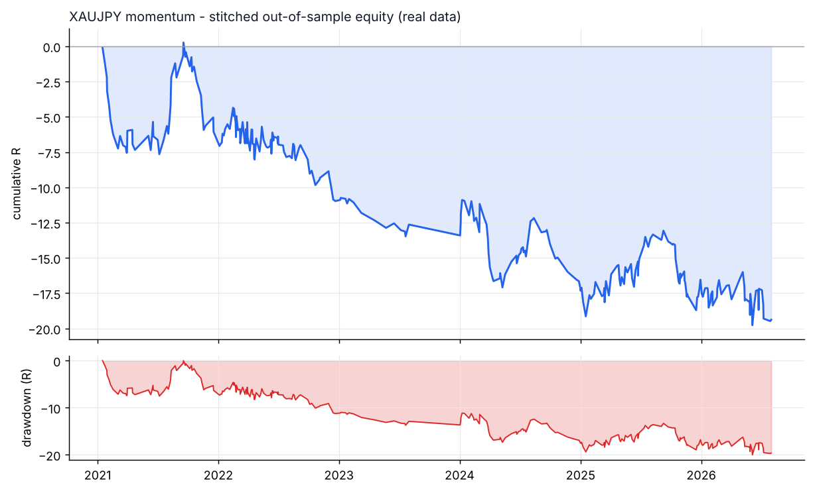
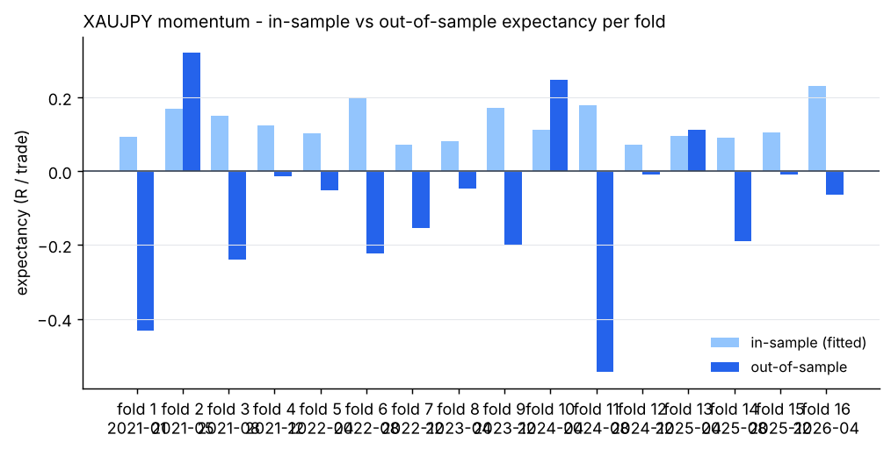
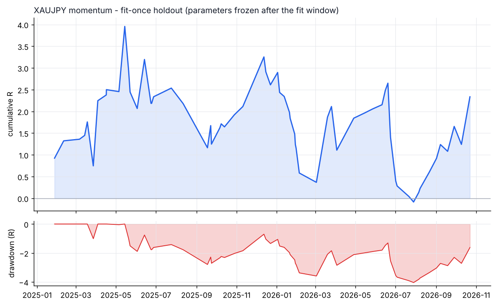

# XAUJPY - momentum - walk-forward result

- data: **real** - data/raw/XAUJPY/*.parquet
- span: 2019-01-02 to 2026-10-30
- folds: 16 x (train 730d / test 120d), contiguous out-of-sample coverage 1920 days
- configurations evaluated: 4,800

## Targets, measured on out-of-sample data only

| Target | Required | Achieved | Result |
|---|---|---|---|
| Trades >= 100 | 100 | 301 | **PASS** |
| Profit factor >= 1.20 | 1.20 | 0.81 | FAIL |
| Win rate >= 50% | 50.0 | 46.2 | FAIL |

## Metrics

| Metric | Walk-forward OOS | Fit-once holdout | Full sample (deployed params) |
|---|---|---|---|
| Trades | 301 | 65 | 518 |
| Win rate % | 46.2 | 53.8 | 56.4 |
| Profit factor | 0.81 | 1.18 | 1.15 |
| Expectancy (R) | -0.064 | 0.036 | 0.052 |
| Avg win (R) | 0.60 | 0.45 | 0.73 |
| Avg loss (R) | -0.63 | -0.44 | -0.82 |
| Payoff | 0.95 | 1.01 | 0.89 |
| Total R | -19.4 | 2.3 | 27.1 |
| Return % | -8.2 | 0.1 | 12.3 |
| Max DD % | 9.7 | 2.7 | 12.7 |
| Max DD (R) | 20.0 | 4.0 | 28.5 |
| Sharpe | -1.36 | 0.03 | 0.41 |
| Sortino | -2.70 | 0.02 | 0.48 |
| CAGR % | -8.0 | 0.0 | 1.2 |
| Calmar | -0.83 | 0.01 | 0.10 |
| Trades/day | 1.01 | 0.11 | 0.21 |
| Avg hold (min) | 301 | 221 | 323 |
| Max consec. losses | 8 | 9 | 7 |
| t-stat of mean R | -1.49 | 0.48 | 1.28 |
| Friction / gross % | 7.7 | 7.8 | 8.4 |

- walk-forward efficiency (OOS / IS expectancy): **-0.50**
- bootstrap p-value for mean R > 0 (OOS): **0.9424**
- neighbourhood stability: 13 neighbours, median score 1.58, 100% positive

## Cost sensitivity (fit-once holdout, parameters frozen)

| cost x | trades | win rate | PF | expectancy R | t |
|---|---|---|---|---|---|
| 0.00 | 66 | 56.1% | 1.38 | +0.070 | 0.95 |
| 0.25 | 66 | 56.1% | 1.33 | +0.062 | 0.84 |
| 0.50 | 66 | 56.1% | 1.28 | +0.054 | 0.74 |
| 0.75 | 66 | 56.1% | 1.24 | +0.046 | 0.63 |
| 1.00 | 65 | 53.8% | 1.18 | +0.036 | 0.48 |
| 1.25 | 65 | 52.3% | 1.09 | +0.020 | 0.27 |
| 1.50 | 65 | 52.3% | 1.05 | +0.012 | 0.16 |

## Per-fold

```
walk-forward folds:
  1: train 2019-01-02..2021-01-01 IS  112tr +0.093R -> test 2021-01-01..2021-05-01 OOS   17tr -0.432R PF 0.26 WR 23.5%
  2: train 2019-05-02..2021-05-01 IS   82tr +0.168R -> test 2021-05-01..2021-08-29 OOS   16tr +0.320R PF 2.05 WR 62.5%
  3: train 2019-08-30..2021-08-29 IS   86tr +0.151R -> test 2021-08-29..2021-12-27 OOS   16tr -0.240R PF 0.55 WR 43.8%
  4: train 2019-12-28..2021-12-27 IS  164tr +0.124R -> test 2021-12-27..2022-04-26 OOS   35tr -0.014R PF 0.96 WR 45.7%
  5: train 2020-04-26..2022-04-26 IS  209tr +0.102R -> test 2022-04-26..2022-08-24 OOS   30tr -0.051R PF 0.79 WR 36.7%
  6: train 2020-08-24..2022-08-24 IS   85tr +0.197R -> test 2022-08-24..2022-12-22 OOS   13tr -0.223R PF 0.44 WR 46.2%
  7: train 2020-12-22..2022-12-22 IS   95tr +0.071R -> test 2022-12-22..2023-04-21 OOS    9tr -0.154R PF 0.28 WR 33.3%
  8: train 2021-04-21..2023-04-21 IS   95tr +0.082R -> test 2023-04-21..2023-08-19 OOS    6tr -0.047R PF 0.80 WR 33.3%
  9: train 2021-12-17..2023-12-17 IS   97tr +0.172R -> test 2023-12-17..2024-04-15 OOS   20tr -0.200R PF 0.59 WR 35.0%
  10: train 2022-04-16..2024-04-15 IS   90tr +0.113R -> test 2024-04-15..2024-08-13 OOS   18tr +0.248R PF 2.91 WR 72.2%
  11: train 2022-08-14..2024-08-13 IS   65tr +0.179R -> test 2024-08-13..2024-12-11 OOS    7tr -0.545R PF 0.06 WR 42.9%
  12: train 2022-12-12..2024-12-11 IS  142tr +0.071R -> test 2024-12-11..2025-04-10 OOS   19tr -0.009R PF 0.97 WR 47.4%
  13: train 2023-04-11..2025-04-10 IS  175tr +0.095R -> test 2025-04-10..2025-08-08 OOS   25tr +0.113R PF 1.50 WR 68.0%
  14: train 2023-08-09..2025-08-08 IS  161tr +0.092R -> test 2025-08-08..2025-12-06 OOS   23tr -0.190R PF 0.32 WR 26.1%
  15: train 2023-12-07..2025-12-06 IS  124tr +0.106R -> test 2025-12-06..2026-04-05 OOS   24tr -0.010R PF 0.96 WR 62.5%
  16: train 2024-04-05..2026-04-05 IS  125tr +0.230R -> test 2026-04-05..2026-08-03 OOS   23tr -0.063R PF 0.84 WR 43.5%
stitched OOS: trades   301 | WR  46.2% | PF  0.81 | exp -0.064R | payoff 0.95 | totR   -19.4 | ret    -8.2% | DD   9.7% | Sharpe -1.36 | t -1.49
walk-forward efficiency: -0.50
```

## Deployed parameters

```json
{
  "strategy": {
    "mode": "momentum",
    "tf_minutes": 30,
    "session": "london",
    "atr_period": 14,
    "atr_rank_lookback": 288,
    "atr_rank_min": 0.1,
    "atr_rank_max": 0.99,
    "sl_atr": 3.0,
    "tp_r": 1.5,
    "min_sl_points": 0.0,
    "min_sl_bp": 30,
    "allow_long": true,
    "allow_short": true,
    "er_period": 24,
    "er_min": 0.3,
    "er_max": 1.0,
    "vwap_anchor_hour": 0,
    "band_k": 2.0,
    "rsi_period": 7,
    "rsi_lo": 28.0,
    "rsi_hi": 72.0,
    "adx_period": 14,
    "adx_max": 30.0,
    "confirm_mode": 2,
    "min_dev_atr": 0.0,
    "bb_period": 48,
    "don_period": 24,
    "ema_fast": 12,
    "ema_slow": 48,
    "adx_min": 20.0,
    "expansion_mult": 1.15,
    "atr_avg_period": 48,
    "pb_slope_period": 30,
    "pb_rsi_lo": 40.0,
    "pb_rsi_hi": 60.0,
    "pb_depth_atr": 0.5,
    "pb_lookback": 6,
    "mom_period": 48,
    "mom_min_atr": 3.5,
    "mom_confirm": 1
  },
  "execution": {
    "point": 1.0,
    "value_per_point_per_lot": 0.6666666666666666,
    "min_lot": 0.01,
    "lot_step": 0.01,
    "max_lot": 20.0,
    "commission_per_lot_rt": 0.0,
    "slippage_points_entry": 18.0,
    "slippage_points_stop": 42.0,
    "swap_long_points": -300.0,
    "swap_short_points": 0.0,
    "initial_equity": 10000.0,
    "risk_pct": 0.005,
    "max_spread_points": 1000000000000.0,
    "be_trigger_r": 0.7,
    "be_offset_r": 0.1,
    "partial_r": 0.0,
    "partial_frac": 0.5,
    "trail_start_r": 0.0,
    "trail_dist_r": 1.0,
    "max_bars": 480,
    "cooldown_bars": 60,
    "max_trades_per_day": 4,
    "daily_loss_limit_r": 1000000000.0,
    "force_exit_hour": 20,
    "force_exit_min": 45,
    "compound": true
  }
}
```

## Out-of-sample breakdown

**by hour**

|   hour |   trades |   win_rate |   total_r |   exp_r |
|-------:|---------:|-----------:|----------:|--------:|
|      6 |        2 |      100   |       3   |   1.5   |
|      7 |       73 |       52.1 |      -2.1 |  -0.029 |
|      8 |       42 |       45.2 |      -2.2 |  -0.052 |
|      9 |       55 |       41.8 |      -6.1 |  -0.112 |
|     10 |       35 |       40   |      -3.5 |  -0.1   |
|     11 |       34 |       50   |      -1.5 |  -0.045 |
|     12 |       22 |       40.9 |      -4   |  -0.182 |
|     13 |        7 |       57.1 |       0.3 |   0.049 |
|     14 |       15 |       46.7 |      -1.2 |  -0.081 |
|     15 |        8 |       25   |      -2   |  -0.246 |
|     16 |        2 |        0   |      -0.3 |  -0.149 |
|     17 |        4 |       50   |      -0.4 |  -0.112 |
|     18 |        1 |      100   |       0.5 |   0.495 |
|     19 |        1 |      100   |       0.2 |   0.189 |

**by direction**

| direction   |   trades |   win_rate |   total_r |   exp_r |
|:------------|---------:|-----------:|----------:|--------:|
| long        |      176 |       48.3 |     -13.6 |  -0.077 |
| short       |      125 |       43.2 |      -5.8 |  -0.046 |

**by exit**

| exit_reason   |   trades |   win_rate |   total_r |   exp_r |
|:--------------|---------:|-----------:|----------:|--------:|
| breakeven     |        3 |      100   |       1   |   0.33  |
| session_close |       17 |       47.1 |       0.9 |   0.05  |
| stop_loss     |       84 |       13.1 |     -72.7 |  -0.865 |
| take_profit   |       52 |      100   |      52.6 |   1.012 |
| time_stop     |      145 |       44.8 |      -1.2 |  -0.008 |

**by year**

|   year |   trades |   win_rate |   total_r |   exp_r |
|-------:|---------:|-----------:|----------:|--------:|
|   2021 |       49 |       42.9 |      -6.1 |  -0.124 |
|   2022 |       78 |       42.3 |      -4.9 |  -0.063 |
|   2023 |       15 |       33.3 |      -1.7 |  -0.111 |
|   2024 |       49 |       46.9 |      -4.7 |  -0.096 |
|   2025 |       69 |       53.6 |       0.8 |   0.011 |
|   2026 |       41 |       48.8 |      -2.8 |  -0.069 |






