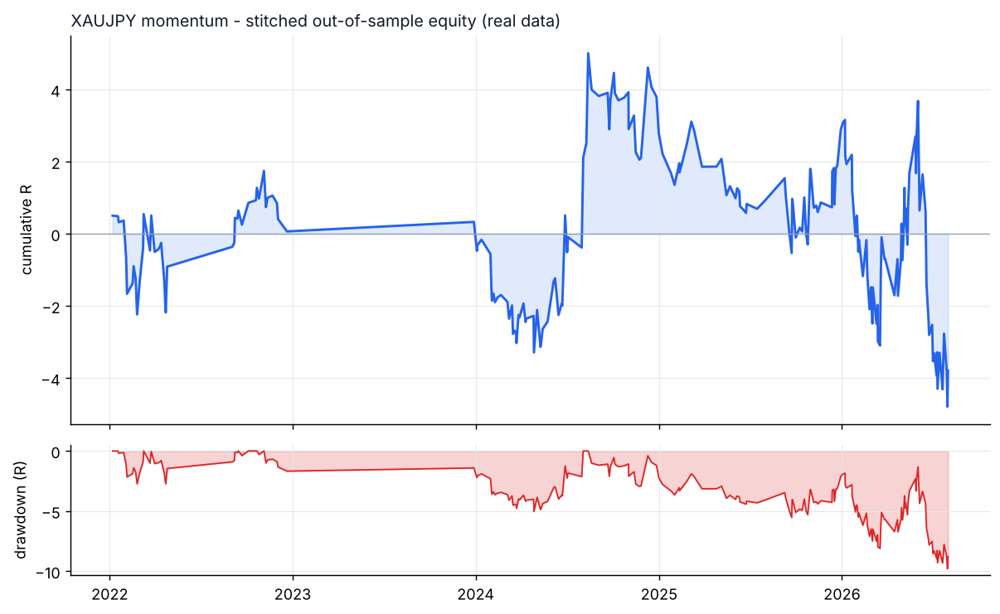
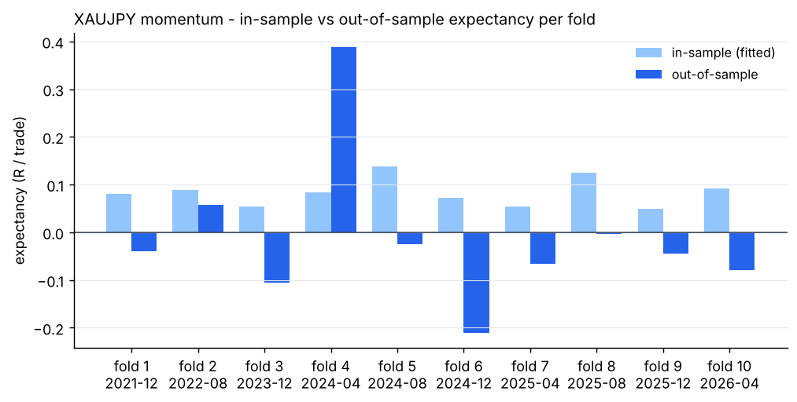

# XAUJPY - momentum - walk-forward result

- data: **real** - data/raw/XAUJPY/*.parquet
- span: 2019-01-02 to 2026-10-30
- folds: 10 x (train 730d / test 120d), contiguous out-of-sample coverage 1200 days
- configurations evaluated: 3,000

## Targets, measured on out-of-sample data only

| Target | Required | Achieved | Result |
|---|---|---|---|
| Trades >= 100 | 100 | 219 | **PASS** |
| Profit factor >= 1.20 | 1.20 | 0.95 | FAIL |
| Win rate >= 50% | 50.0 | 50.7 | **PASS** |

## Metrics

| Metric | Walk-forward OOS | Full sample (deployed params) |
|---|---|---|
| Trades | 219 | 932 |
| Win rate % | 50.7 | 48.0 |
| Profit factor | 0.95 | 0.91 |
| Expectancy (R) | -0.017 | -0.040 |
| Avg win (R) | 0.59 | 0.83 |
| Avg loss (R) | -0.64 | -0.85 |
| Payoff | 0.92 | 0.99 |
| Total R | -3.8 | -37.7 |
| Return % | -2.6 | -16.0 |
| Max DD % | 4.9 | 25.5 |
| Max DD (R) | 9.8 | 62.4 |
| Sharpe | -0.41 | -0.44 |
| Sortino | -0.82 | -0.76 |
| CAGR % | -2.3 | -1.8 |
| Calmar | -0.48 | -0.07 |
| Trades/day | 1.00 | 0.38 |
| Avg hold (min) | 291 | 300 |
| Max consec. losses | 6 | 12 |
| t-stat of mean R | -0.33 | -1.38 |
| Friction / gross % | 7.3 | 7.5 |

- walk-forward efficiency (OOS / IS expectancy): **-0.21**
- bootstrap p-value for mean R > 0 (OOS): **0.6278**
- neighbourhood stability: 10 neighbours, median score 1.34, 100% positive

## Per-fold

```
walk-forward folds:
  1: train 2019-12-28..2021-12-27 IS  109tr +0.081R -> test 2021-12-27..2022-04-26 OOS   23tr -0.040R PF 0.88 WR 52.2%
  2: train 2020-08-24..2022-08-24 IS  107tr +0.088R -> test 2022-08-24..2022-12-22 OOS   17tr +0.057R PF 1.36 WR 58.8%
  3: train 2021-12-17..2023-12-17 IS  114tr +0.054R -> test 2023-12-17..2024-04-15 OOS   23tr -0.105R PF 0.53 WR 47.8%
  4: train 2022-04-16..2024-04-15 IS  107tr +0.083R -> test 2024-04-15..2024-08-13 OOS   19tr +0.387R PF 2.66 WR 68.4%
  5: train 2022-08-14..2024-08-13 IS  111tr +0.138R -> test 2024-08-13..2024-12-11 OOS   16tr -0.025R PF 0.92 WR 50.0%
  6: train 2022-12-12..2024-12-11 IS  124tr +0.072R -> test 2024-12-11..2025-04-10 OOS   13tr -0.211R PF 0.42 WR 30.8%
  7: train 2023-04-11..2025-04-10 IS  127tr +0.054R -> test 2025-04-10..2025-08-08 OOS   14tr -0.067R PF 0.57 WR 42.9%
  8: train 2023-08-09..2025-08-08 IS  114tr +0.124R -> test 2025-08-08..2025-12-06 OOS   20tr -0.003R PF 0.99 WR 45.0%
  9: train 2023-12-07..2025-12-06 IS  226tr +0.049R -> test 2025-12-06..2026-04-05 OOS   35tr -0.045R PF 0.87 WR 54.3%
  10: train 2024-04-05..2026-04-05 IS  228tr +0.092R -> test 2026-04-05..2026-08-03 OOS   39tr -0.080R PF 0.84 WR 48.7%
stitched OOS: trades   219 | WR  50.7% | PF  0.95 | exp -0.017R | payoff 0.92 | totR    -3.8 | ret    -2.6% | DD   4.9% | Sharpe -0.41 | t -0.33
walk-forward efficiency: -0.21
```

## Deployed parameters

```json
{
  "strategy": {
    "mode": "momentum",
    "tf_minutes": 15,
    "session": "london",
    "atr_period": 14,
    "atr_rank_lookback": 288,
    "atr_rank_min": 0.1,
    "atr_rank_max": 0.99,
    "sl_atr": 3.0,
    "tp_r": 1.0,
    "min_sl_points": 0.0,
    "min_sl_bp": 45,
    "allow_long": true,
    "allow_short": true,
    "er_period": 24,
    "er_min": 0.3,
    "er_max": 1.0,
    "vwap_anchor_hour": 0,
    "band_k": 2.0,
    "rsi_period": 7,
    "rsi_lo": 28.0,
    "rsi_hi": 72.0,
    "adx_period": 14,
    "adx_max": 30.0,
    "confirm_mode": 2,
    "min_dev_atr": 0.0,
    "bb_period": 48,
    "don_period": 24,
    "ema_fast": 12,
    "ema_slow": 48,
    "adx_min": 20.0,
    "expansion_mult": 1.15,
    "atr_avg_period": 48,
    "pb_slope_period": 30,
    "pb_rsi_lo": 40.0,
    "pb_rsi_hi": 60.0,
    "pb_depth_atr": 0.5,
    "pb_lookback": 6,
    "mom_period": 48,
    "mom_min_atr": 3.5,
    "mom_confirm": 0
  },
  "execution": {
    "point": 1.0,
    "value_per_point_per_lot": 0.6666666666666666,
    "min_lot": 0.01,
    "lot_step": 0.01,
    "max_lot": 20.0,
    "commission_per_lot_rt": 0.0,
    "slippage_points_entry": 18.0,
    "slippage_points_stop": 42.0,
    "swap_long_points": -300.0,
    "swap_short_points": 0.0,
    "initial_equity": 10000.0,
    "risk_pct": 0.005,
    "max_spread_points": 1000000000000.0,
    "be_trigger_r": 0.0,
    "be_offset_r": 0.1,
    "partial_r": 0.0,
    "partial_frac": 0.5,
    "trail_start_r": 0.0,
    "trail_dist_r": 1.0,
    "max_bars": 480,
    "cooldown_bars": 240,
    "max_trades_per_day": 2,
    "daily_loss_limit_r": 1000000000.0,
    "force_exit_hour": 20,
    "force_exit_min": 45,
    "compound": true
  }
}
```

## Out-of-sample breakdown

**by hour**

|   hour |   trades |   win_rate |   total_r |   exp_r |
|-------:|---------:|-----------:|----------:|--------:|
|      6 |       14 |       28.6 |      -7.9 |  -0.561 |
|      7 |       55 |       54.5 |       1.1 |   0.019 |
|      8 |       43 |       51.2 |       2.1 |   0.049 |
|      9 |       30 |       56.7 |       3.3 |   0.108 |
|     10 |       23 |       39.1 |      -2.8 |  -0.123 |
|     11 |       16 |       56.2 |      -0.1 |  -0.003 |
|     12 |        4 |       75   |       1   |   0.242 |
|     13 |        6 |       33.3 |      -1.4 |  -0.226 |
|     14 |       11 |       54.5 |       1.5 |   0.133 |
|     15 |        7 |       42.9 |      -1   |  -0.143 |
|     16 |        3 |       66.7 |       0   |   0.003 |
|     17 |        4 |       75   |       0.2 |   0.061 |
|     18 |        1 |        0   |      -0.1 |  -0.136 |
|     19 |        2 |       50   |       0.3 |   0.16  |

**by direction**

| direction   |   trades |   win_rate |   total_r |   exp_r |
|:------------|---------:|-----------:|----------:|--------:|
| long        |      126 |       48.4 |      -4   |  -0.032 |
| short       |       93 |       53.8 |       0.2 |   0.003 |

**by exit**

| exit_reason   |   trades |   win_rate |   total_r |   exp_r |
|:--------------|---------:|-----------:|----------:|--------:|
| breakeven     |        1 |      100   |       0.3 |   0.347 |
| session_close |       24 |       45.8 |      -1.4 |  -0.059 |
| stop_loss     |       66 |       22.7 |     -47.6 |  -0.721 |
| take_profit   |       30 |      100   |      35.3 |   1.177 |
| time_stop     |       98 |       55.1 |       9.6 |   0.098 |

**by year**

|   year |   trades |   win_rate |   total_r |   exp_r |
|-------:|---------:|-----------:|----------:|--------:|
|   2022 |       40 |       55   |       0.1 |   0.002 |
|   2023 |        1 |      100   |       0.3 |   0.264 |
|   2024 |       60 |       51.7 |       2.5 |   0.041 |
|   2025 |       51 |       47.1 |       0.1 |   0.002 |
|   2026 |       67 |       49.3 |      -6.7 |  -0.1   |





