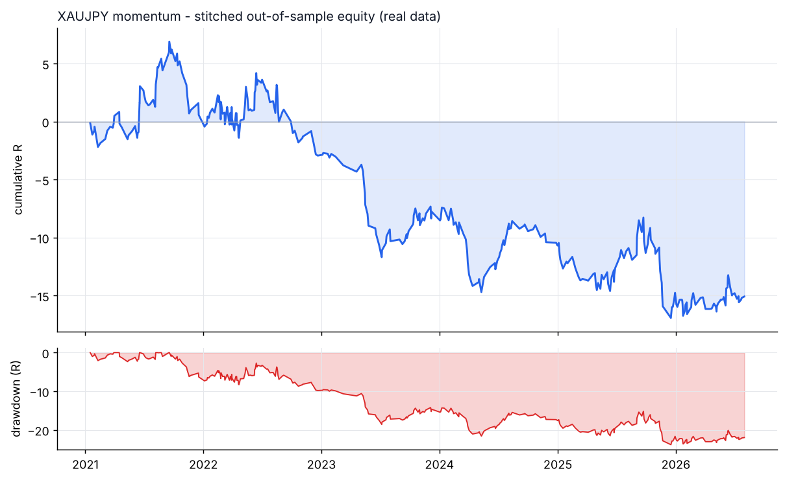
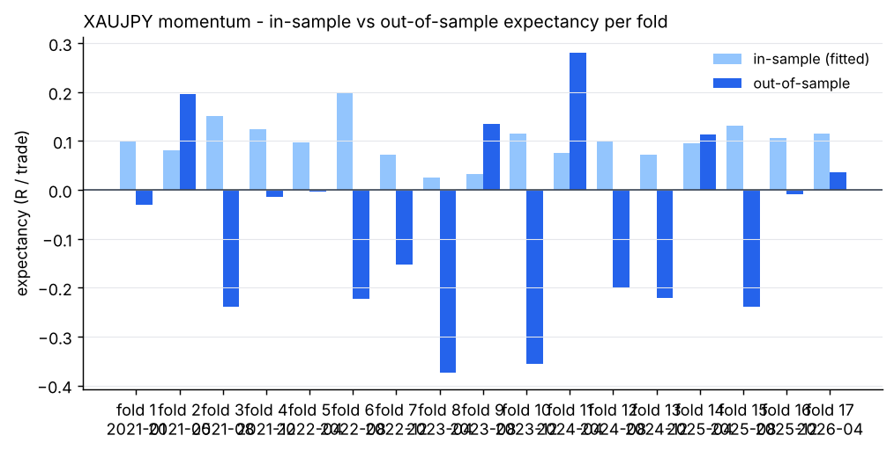
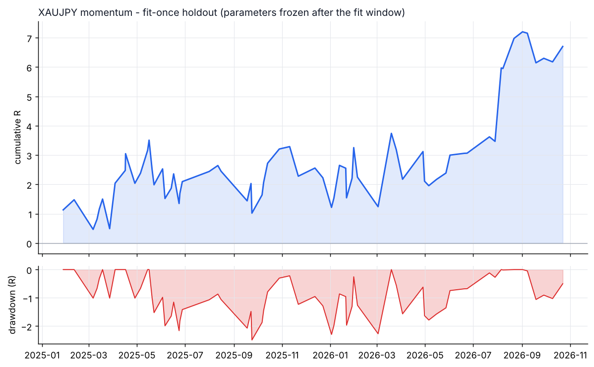

# XAUJPY - momentum - walk-forward result

- data: **real** - data/raw/XAUJPY/*.parquet
- span: 2019-01-02 to 2026-10-30
- folds: 17 x (train 730d / test 120d), contiguous out-of-sample coverage 2040 days
- configurations evaluated: 5,100

## Targets, measured on out-of-sample data only

| Target | Required | Achieved | Result |
|---|---|---|---|
| Trades >= 100 | 100 | 342 | **PASS** |
| Profit factor >= 1.20 | 1.20 | 0.86 | FAIL |
| Win rate >= 50% | 50.0 | 52.3 | **PASS** |

## Metrics

| Metric | Walk-forward OOS | Fit-once holdout | Full sample (deployed params) |
|---|---|---|---|
| Trades | 342 | 68 | 848 |
| Win rate % | 52.3 | 61.8 | 49.9 |
| Profit factor | 0.86 | 1.37 | 0.98 |
| Expectancy (R) | -0.044 | 0.099 | -0.005 |
| Avg win (R) | 0.53 | 0.60 | 0.48 |
| Avg loss (R) | -0.67 | -0.71 | -0.49 |
| Payoff | 0.79 | 0.85 | 0.98 |
| Total R | -15.1 | 6.7 | -4.4 |
| Return % | -5.9 | 2.8 | -5.5 |
| Max DD % | 11.4 | 2.1 | 17.2 |
| Max DD (R) | 23.8 | 2.5 | 39.1 |
| Sharpe | -0.97 | 0.62 | -0.17 |
| Sortino | -1.92 | 0.42 | -0.15 |
| CAGR % | -5.6 | 1.2 | -0.6 |
| Calmar | -0.50 | 0.58 | -0.03 |
| Trades/day | 1.01 | 0.12 | 0.35 |
| Avg hold (min) | 283 | 358 | 328 |
| Max consec. losses | 10 | 2 | 10 |
| t-stat of mean R | -1.12 | 1.01 | -0.23 |
| Friction / gross % | 9.0 | 6.0 | 9.8 |

- walk-forward efficiency (OOS / IS expectancy): **-0.44**
- bootstrap p-value for mean R > 0 (OOS): **0.8622**
- neighbourhood stability: 15 neighbours, median score 1.05, 100% positive

## Cost sensitivity (fit-once holdout, parameters frozen)

| cost x | trades | win rate | PF | expectancy R | t |
|---|---|---|---|---|---|
| 0.00 | 68 | 64.7% | 1.61 | +0.151 | 1.56 |
| 0.25 | 68 | 64.7% | 1.55 | +0.137 | 1.42 |
| 0.50 | 68 | 64.7% | 1.52 | +0.130 | 1.35 |
| 0.75 | 68 | 63.2% | 1.49 | +0.123 | 1.28 |
| 1.00 | 68 | 61.8% | 1.37 | +0.099 | 1.01 |
| 1.25 | 68 | 57.4% | 1.18 | +0.055 | 0.55 |
| 1.50 | 68 | 57.4% | 1.11 | +0.034 | 0.34 |

## Per-fold

```
walk-forward folds:
  1: train 2019-01-02..2021-01-01 IS  112tr +0.099R -> test 2021-01-01..2021-05-01 OOS   17tr -0.030R PF 0.88 WR 58.8%
  2: train 2019-05-02..2021-05-01 IS  163tr +0.080R -> test 2021-05-01..2021-08-29 OOS   25tr +0.197R PF 1.92 WR 56.0%
  3: train 2019-08-30..2021-08-29 IS   86tr +0.151R -> test 2021-08-29..2021-12-27 OOS   16tr -0.240R PF 0.55 WR 43.8%
  4: train 2019-12-28..2021-12-27 IS  164tr +0.124R -> test 2021-12-27..2022-04-26 OOS   35tr -0.014R PF 0.96 WR 45.7%
  5: train 2020-04-26..2022-04-26 IS  212tr +0.098R -> test 2022-04-26..2022-08-24 OOS   31tr -0.004R PF 0.99 WR 61.3%
  6: train 2020-08-24..2022-08-24 IS   85tr +0.197R -> test 2022-08-24..2022-12-22 OOS   13tr -0.223R PF 0.44 WR 46.2%
  7: train 2020-12-22..2022-12-22 IS   95tr +0.071R -> test 2022-12-22..2023-04-21 OOS    9tr -0.154R PF 0.28 WR 33.3%
  8: train 2021-04-21..2023-04-21 IS  182tr +0.026R -> test 2023-04-21..2023-08-19 OOS   16tr -0.375R PF 0.33 WR 31.2%
  9: train 2021-08-19..2023-08-19 IS   87tr +0.033R -> test 2023-08-19..2023-12-17 OOS   19tr +0.135R PF 1.64 WR 68.4%
  10: train 2021-12-17..2023-12-17 IS   82tr +0.115R -> test 2023-12-17..2024-04-15 OOS   18tr -0.357R PF 0.34 WR 27.8%
  11: train 2022-04-16..2024-04-15 IS   95tr +0.076R -> test 2024-04-15..2024-08-13 OOS   20tr +0.280R PF 3.18 WR 70.0%
  12: train 2022-08-14..2024-08-13 IS   89tr +0.099R -> test 2024-08-13..2024-12-11 OOS    9tr -0.202R PF 0.39 WR 55.6%
  13: train 2022-12-12..2024-12-11 IS   97tr +0.072R -> test 2024-12-11..2025-04-10 OOS   15tr -0.221R PF 0.31 WR 26.7%
  14: train 2023-04-11..2025-04-10 IS  175tr +0.095R -> test 2025-04-10..2025-08-08 OOS   25tr +0.113R PF 1.50 WR 68.0%
  15: train 2023-08-09..2025-08-08 IS  179tr +0.132R -> test 2025-08-08..2025-12-06 OOS   21tr -0.239R PF 0.59 WR 38.1%
  16: train 2023-12-07..2025-12-06 IS  124tr +0.106R -> test 2025-12-06..2026-04-05 OOS   24tr -0.010R PF 0.96 WR 62.5%
  17: train 2024-04-05..2026-04-05 IS  190tr +0.116R -> test 2026-04-05..2026-08-03 OOS   29tr +0.037R PF 1.25 WR 62.1%
stitched OOS: trades   342 | WR  52.3% | PF  0.86 | exp -0.044R | payoff 0.79 | totR   -15.1 | ret    -5.9% | DD  11.4% | Sharpe -0.97 | t -1.12
walk-forward efficiency: -0.44
```

## Deployed parameters

```json
{
  "strategy": {
    "mode": "momentum",
    "tf_minutes": 30,
    "session": "extended",
    "atr_period": 14,
    "atr_rank_lookback": 288,
    "atr_rank_min": 0.1,
    "atr_rank_max": 0.99,
    "sl_atr": 4.0,
    "tp_r": 2.5,
    "min_sl_points": 0.0,
    "min_sl_bp": 30,
    "allow_long": true,
    "allow_short": true,
    "er_period": 24,
    "er_min": 0.3,
    "er_max": 1.0,
    "vwap_anchor_hour": 0,
    "band_k": 2.0,
    "rsi_period": 7,
    "rsi_lo": 28.0,
    "rsi_hi": 72.0,
    "adx_period": 14,
    "adx_max": 30.0,
    "confirm_mode": 2,
    "min_dev_atr": 0.0,
    "bb_period": 48,
    "don_period": 24,
    "ema_fast": 12,
    "ema_slow": 48,
    "adx_min": 20.0,
    "expansion_mult": 1.15,
    "atr_avg_period": 48,
    "pb_slope_period": 30,
    "pb_rsi_lo": 40.0,
    "pb_rsi_hi": 60.0,
    "pb_depth_atr": 0.5,
    "pb_lookback": 6,
    "mom_period": 12,
    "mom_min_atr": 3.5,
    "mom_confirm": 1
  },
  "execution": {
    "point": 1.0,
    "value_per_point_per_lot": 0.6666666666666666,
    "min_lot": 0.01,
    "lot_step": 0.01,
    "max_lot": 20.0,
    "commission_per_lot_rt": 0.0,
    "slippage_points_entry": 18.0,
    "slippage_points_stop": 42.0,
    "swap_long_points": -300.0,
    "swap_short_points": 0.0,
    "initial_equity": 10000.0,
    "risk_pct": 0.005,
    "max_spread_points": 1000000000000.0,
    "be_trigger_r": 0.7,
    "be_offset_r": 0.1,
    "partial_r": 0.0,
    "partial_frac": 0.5,
    "trail_start_r": 0.0,
    "trail_dist_r": 1.0,
    "max_bars": 480,
    "cooldown_bars": 60,
    "max_trades_per_day": 4,
    "daily_loss_limit_r": 1000000000.0,
    "force_exit_hour": 20,
    "force_exit_min": 45,
    "compound": true
  }
}
```

## Out-of-sample breakdown

**by hour**

|   hour |   trades |   win_rate |   total_r |   exp_r |
|-------:|---------:|-----------:|----------:|--------:|
|      6 |        1 |      100   |       0.2 |   0.223 |
|      7 |       87 |       59.8 |       2.2 |   0.026 |
|      8 |       45 |       46.7 |      -6.3 |  -0.141 |
|      9 |       48 |       52.1 |      -0.7 |  -0.015 |
|     10 |       33 |       33.3 |     -11.2 |  -0.339 |
|     11 |       31 |       54.8 |       0.2 |   0.008 |
|     12 |       30 |       53.3 |      -1.4 |  -0.047 |
|     13 |       16 |       68.8 |       2.8 |   0.172 |
|     14 |       20 |       70   |       2.6 |   0.131 |
|     15 |       10 |       30   |      -1.6 |  -0.156 |
|     16 |        9 |       33.3 |      -0.2 |  -0.017 |
|     17 |        6 |       50   |      -0.9 |  -0.149 |
|     18 |        2 |       50   |      -0.7 |  -0.36  |
|     19 |        3 |       33.3 |      -0.1 |  -0.034 |
|     20 |        1 |        0   |      -0   |  -0.034 |

**by direction**

| direction   |   trades |   win_rate |   total_r |   exp_r |
|:------------|---------:|-----------:|----------:|--------:|
| long        |      195 |       52.8 |      -9.8 |  -0.05  |
| short       |      147 |       51.7 |      -5.3 |  -0.036 |

**by exit**

| exit_reason   |   trades |   win_rate |   total_r |   exp_r |
|:--------------|---------:|-----------:|----------:|--------:|
| breakeven     |       18 |      100   |       6   |   0.336 |
| session_close |       37 |       56.8 |       4.4 |   0.118 |
| stop_loss     |       98 |       20.4 |     -77.3 |  -0.789 |
| take_profit   |       55 |      100   |      49.1 |   0.893 |
| time_stop     |      134 |       48.5 |       2.7 |   0.02  |

**by year**

|   year |   trades |   win_rate |   total_r |   exp_r |
|-------:|---------:|-----------:|----------:|--------:|
|   2021 |       58 |       53.4 |       0.6 |   0.01  |
|   2022 |       79 |       51.9 |      -3.5 |  -0.044 |
|   2023 |       44 |       47.7 |      -4.8 |  -0.109 |
|   2024 |       50 |       48   |      -2.9 |  -0.059 |
|   2025 |       64 |       53.1 |      -4.1 |  -0.064 |
|   2026 |       47 |       59.6 |      -0.3 |  -0.007 |






