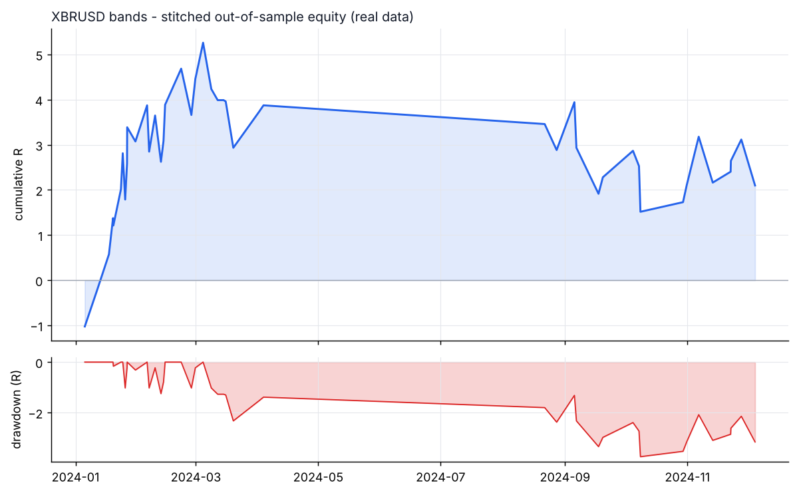
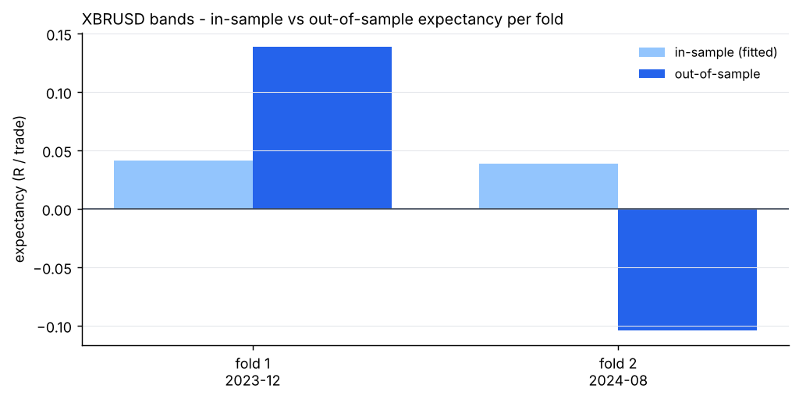

# XBRUSD - bands - walk-forward result

- data: **real** - data/raw/XBRUSD/*.parquet
- span: 2019-01-02 to 2026-10-30
- folds: 2 x (train 730d / test 120d), contiguous out-of-sample coverage 240 days
- configurations evaluated: 600

## Targets, measured on out-of-sample data only

| Target | Required | Achieved | Result |
|---|---|---|---|
| Trades >= 100 | 100 | 45 | FAIL |
| Profit factor >= 1.01 | 1.01 | 1.15 | **PASS** |
| Win rate >= 57% | 57.0 | 57.8 | **PASS** |

## Metrics

| Metric | Walk-forward OOS | Full sample (deployed params) |
|---|---|---|
| Trades | 45 | 449 |
| Win rate % | 57.8 | 61.2 |
| Profit factor | 1.15 | 0.84 |
| Expectancy (R) | 0.047 | -0.047 |
| Avg win (R) | 0.63 | 0.41 |
| Avg loss (R) | -0.75 | -0.77 |
| Payoff | 0.84 | 0.53 |
| Total R | 2.1 | -21.1 |
| Return % | 1.0 | -9.7 |
| Max DD % | 1.9 | 11.6 |
| Max DD (R) | 3.7 | 24.9 |
| Sharpe | 1.51 | -0.54 |
| Sortino | 3.37 | -0.42 |
| CAGR % | 6.3 | -1.1 |
| Calmar | 3.37 | -0.10 |
| Trades/day | 1.07 | 0.20 |
| Avg hold (min) | 112 | 129 |
| Max consec. losses | 2 | 5 |
| t-stat of mean R | 0.41 | -1.51 |
| Friction / gross % | 14.1 | 13.9 |

- walk-forward efficiency (OOS / IS expectancy): **1.17**
- bootstrap p-value for mean R > 0 (OOS): **0.3400**
- neighbourhood stability: 11 neighbours, median score 0.35, 100% positive

## Per-fold

```
walk-forward folds:
  1: train 2021-12-17..2023-12-17 IS  160tr +0.042R -> test 2023-12-17..2024-04-15 OOS   28tr +0.138R PF 1.49 WR 60.7%
  2: train 2022-08-14..2024-08-13 IS  128tr +0.038R -> test 2024-08-13..2024-12-11 OOS   17tr -0.104R PF 0.72 WR 52.9%
stitched OOS: trades    45 | WR  57.8% | PF  1.15 | exp +0.047R | payoff 0.84 | totR    +2.1 | ret    +1.0% | DD   1.9% | Sharpe  1.51 | t  0.41
walk-forward efficiency: 1.17
```

## Deployed parameters

```json
{
  "strategy": {
    "mode": "bands",
    "tf_minutes": 15,
    "session": "ny",
    "atr_period": 14,
    "atr_rank_lookback": 288,
    "atr_rank_min": 0.1,
    "atr_rank_max": 0.99,
    "sl_atr": 3.0,
    "tp_r": 1.5,
    "min_sl_points": 0.0,
    "min_sl_bp": 15,
    "allow_long": true,
    "allow_short": true,
    "er_period": 24,
    "er_min": 0.0,
    "er_max": 0.3,
    "vwap_anchor_hour": 0,
    "band_k": 1.5,
    "rsi_period": 7,
    "rsi_lo": 28,
    "rsi_hi": 72.0,
    "adx_period": 14,
    "adx_max": 100,
    "confirm_mode": 1,
    "min_dev_atr": 0.0,
    "bb_period": 48,
    "don_period": 24,
    "ema_fast": 12,
    "ema_slow": 48,
    "adx_min": 20.0,
    "expansion_mult": 1.15,
    "atr_avg_period": 48,
    "pb_slope_period": 30,
    "pb_rsi_lo": 40.0,
    "pb_rsi_hi": 60.0,
    "pb_depth_atr": 0.5,
    "pb_lookback": 6,
    "mom_period": 24,
    "mom_min_atr": 1.0,
    "mom_confirm": 1,
    "orb_hour": 7,
    "orb_bars": 4,
    "orb_buffer_atr": 0.0,
    "orb_fade": 0,
    "r2_period": 2,
    "r2_lo": 10.0,
    "trend_ema": 100,
    "sweep_lookback": 24,
    "sweep_wick_atr": 0.3
  },
  "execution": {
    "point": 0.001,
    "value_per_point_per_lot": 1.0,
    "min_lot": 0.01,
    "lot_step": 0.01,
    "max_lot": 50.0,
    "commission_per_lot_rt": 0.0,
    "slippage_points_entry": 5.0,
    "slippage_points_stop": 12.0,
    "swap_long_points": 0.0,
    "swap_short_points": 0.0,
    "initial_equity": 10000.0,
    "risk_pct": 0.005,
    "max_spread_points": 1000000000000.0,
    "be_trigger_r": 0.5,
    "be_offset_r": 0.1,
    "partial_r": 0.4,
    "partial_frac": 0.5,
    "trail_start_r": 0.8,
    "trail_dist_r": 1.0,
    "max_bars": 240,
    "cooldown_bars": 5,
    "max_trades_per_day": 2,
    "daily_loss_limit_r": 1000000000.0,
    "force_exit_hour": 20,
    "force_exit_min": 45,
    "compound": true
  }
}
```

## Out-of-sample breakdown

**by hour**

|   hour |   trades |   win_rate |   total_r |   exp_r |
|-------:|---------:|-----------:|----------:|--------:|
|     12 |        3 |      100   |       1.2 |   0.394 |
|     13 |        7 |       57.1 |      -0   |  -0.002 |
|     14 |        8 |       37.5 |      -2.7 |  -0.339 |
|     15 |       10 |       60   |       0   |   0.004 |
|     16 |        8 |       62.5 |       1.3 |   0.165 |
|     17 |        7 |       42.9 |       1   |   0.144 |
|     18 |        2 |      100   |       1.3 |   0.631 |

**by direction**

| direction   |   trades |   win_rate |   total_r |   exp_r |
|:------------|---------:|-----------:|----------:|--------:|
| long        |       21 |       57.1 |       1.1 |   0.054 |
| short       |       24 |       58.3 |       1   |   0.041 |

**by exit**

| exit_reason   |   trades |   win_rate |   total_r |   exp_r |
|:--------------|---------:|-----------:|----------:|--------:|
| breakeven     |        3 |      100   |       0.7 |   0.232 |
| session_close |        8 |       37.5 |       0.4 |   0.053 |
| stop_loss     |       12 |        0   |     -12.2 |  -1.021 |
| take_profit   |       16 |      100   |      13.3 |   0.832 |
| time_stop     |        6 |       66.7 |      -0.1 |  -0.016 |

**by year**

|   year |   trades |   win_rate |   total_r |   exp_r |
|-------:|---------:|-----------:|----------:|--------:|
|   2024 |       45 |       57.8 |       2.1 |   0.047 |





