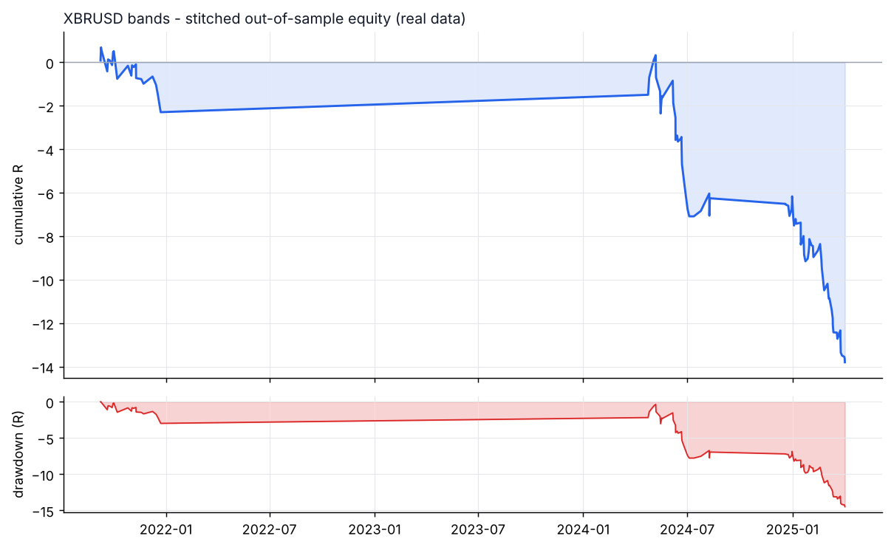
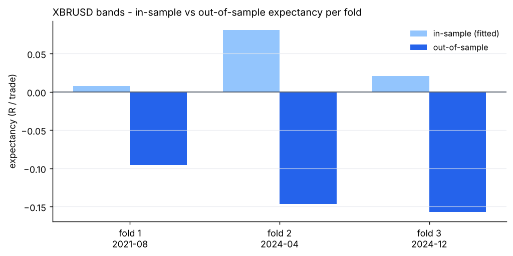

# XBRUSD - bands - walk-forward result

- data: **real** - data/raw/XBRUSD/*.parquet
- span: 2019-01-02 to 2026-10-30
- folds: 3 x (train 730d / test 120d), contiguous out-of-sample coverage 360 days
- configurations evaluated: 900

## Targets, measured on out-of-sample data only

| Target | Required | Achieved | Result |
|---|---|---|---|
| Trades >= 100 | 100 | 99 | FAIL |
| Profit factor >= 1.01 | 1.01 | 0.51 | FAIL |
| Win rate >= 57% | 57.0 | 39.4 | FAIL |

## Metrics

| Metric | Walk-forward OOS | Full sample (deployed params) |
|---|---|---|
| Trades | 99 | 1248 |
| Win rate % | 39.4 | 55.1 |
| Profit factor | 0.51 | 0.80 |
| Expectancy (R) | -0.139 | -0.035 |
| Avg win (R) | 0.36 | 0.25 |
| Avg loss (R) | -0.47 | -0.38 |
| Payoff | 0.78 | 0.65 |
| Total R | -13.8 | -44.0 |
| Return % | -6.4 | -17.0 |
| Max DD % | 7.0 | 18.4 |
| Max DD (R) | 14.5 | 46.8 |
| Sharpe | -4.71 | -1.03 |
| Sortino | -6.62 | -0.89 |
| CAGR % | -18.8 | -2.1 |
| Calmar | -2.68 | -0.11 |
| Trades/day | 1.18 | 0.56 |
| Avg hold (min) | 135 | 121 |
| Max consec. losses | 6 | 7 |
| t-stat of mean R | -2.67 | -3.20 |
| Friction / gross % | 17.3 | 14.1 |

- walk-forward efficiency (OOS / IS expectancy): **-3.81**
- bootstrap p-value for mean R > 0 (OOS): **0.9964**
- neighbourhood stability: 16 neighbours, median score 0.38, 100% positive

## Per-fold

```
walk-forward folds:
  1: train 2019-08-30..2021-08-29 IS  127tr +0.008R -> test 2021-08-29..2021-12-27 OOS   24tr -0.096R PF 0.60 WR 41.7%
  2: train 2022-04-16..2024-04-15 IS  152tr +0.081R -> test 2024-04-15..2024-08-13 OOS   27tr -0.147R PF 0.62 WR 44.4%
  3: train 2022-12-12..2024-12-11 IS  328tr +0.021R -> test 2024-12-11..2025-04-10 OOS   48tr -0.157R PF 0.36 WR 35.4%
stitched OOS: trades    99 | WR  39.4% | PF  0.51 | exp -0.139R | payoff 0.78 | totR   -13.8 | ret    -6.4% | DD   7.0% | Sharpe -4.71 | t -2.67
walk-forward efficiency: -3.81
```

## Deployed parameters

```json
{
  "strategy": {
    "mode": "bands",
    "tf_minutes": 30,
    "session": "extended",
    "atr_period": 14,
    "atr_rank_lookback": 288,
    "atr_rank_min": 0.1,
    "atr_rank_max": 0.99,
    "sl_atr": 4.0,
    "tp_r": 0.3,
    "min_sl_points": 0.0,
    "min_sl_bp": 25,
    "allow_long": true,
    "allow_short": true,
    "er_period": 24,
    "er_min": 0.0,
    "er_max": 0.3,
    "vwap_anchor_hour": 0,
    "band_k": 1.5,
    "rsi_period": 7,
    "rsi_lo": 28,
    "rsi_hi": 72.0,
    "adx_period": 14,
    "adx_max": 30,
    "confirm_mode": 2,
    "min_dev_atr": 0.0,
    "bb_period": 48,
    "don_period": 24,
    "ema_fast": 12,
    "ema_slow": 48,
    "adx_min": 20.0,
    "expansion_mult": 1.15,
    "atr_avg_period": 48,
    "pb_slope_period": 30,
    "pb_rsi_lo": 40.0,
    "pb_rsi_hi": 60.0,
    "pb_depth_atr": 0.5,
    "pb_lookback": 6,
    "mom_period": 24,
    "mom_min_atr": 1.0,
    "mom_confirm": 1,
    "orb_hour": 7,
    "orb_bars": 4,
    "orb_buffer_atr": 0.0,
    "orb_fade": 0,
    "r2_period": 2,
    "r2_lo": 10.0,
    "trend_ema": 100,
    "sweep_lookback": 24,
    "sweep_wick_atr": 0.3
  },
  "execution": {
    "point": 0.001,
    "value_per_point_per_lot": 1.0,
    "min_lot": 0.01,
    "lot_step": 0.01,
    "max_lot": 50.0,
    "commission_per_lot_rt": 0.0,
    "slippage_points_entry": 5.0,
    "slippage_points_stop": 12.0,
    "swap_long_points": 0.0,
    "swap_short_points": 0.0,
    "initial_equity": 10000.0,
    "risk_pct": 0.005,
    "max_spread_points": 1000000000000.0,
    "be_trigger_r": 0.3,
    "be_offset_r": 0.1,
    "partial_r": 0.4,
    "partial_frac": 0.5,
    "trail_start_r": 0.8,
    "trail_dist_r": 1.0,
    "max_bars": 180,
    "cooldown_bars": 60,
    "max_trades_per_day": 4,
    "daily_loss_limit_r": 1000000000.0,
    "force_exit_hour": 20,
    "force_exit_min": 45,
    "compound": true
  }
}
```

## Out-of-sample breakdown

**by hour**

|   hour |   trades |   win_rate |   total_r |   exp_r |
|-------:|---------:|-----------:|----------:|--------:|
|      7 |        2 |      100   |       1.1 |   0.55  |
|      8 |        5 |        0   |      -3.1 |  -0.615 |
|      9 |        8 |       37.5 |      -2.3 |  -0.285 |
|     10 |       10 |       70   |       2.3 |   0.231 |
|     11 |        4 |       50   |      -0.5 |  -0.118 |
|     12 |        4 |       50   |      -1.1 |  -0.275 |
|     13 |       10 |       40   |      -2.8 |  -0.279 |
|     14 |       11 |       54.5 |      -1.3 |  -0.117 |
|     15 |       10 |       30   |      -1   |  -0.102 |
|     16 |       12 |       16.7 |      -2.9 |  -0.239 |
|     17 |        8 |       50   |      -0.1 |  -0.011 |
|     18 |        9 |       33.3 |      -1.9 |  -0.217 |
|     19 |        4 |        0   |      -0.2 |  -0.059 |
|     20 |        2 |       50   |      -0   |  -0.02  |

**by direction**

| direction   |   trades |   win_rate |   total_r |   exp_r |
|:------------|---------:|-----------:|----------:|--------:|
| long        |       48 |       41.7 |      -4.7 |  -0.097 |
| short       |       51 |       37.3 |      -9.1 |  -0.179 |

**by exit**

| exit_reason   |   trades |   win_rate |   total_r |   exp_r |
|:--------------|---------:|-----------:|----------:|--------:|
| session_close |       15 |       26.7 |      -2.2 |  -0.148 |
| stop_loss     |       15 |        6.7 |     -14.2 |  -0.946 |
| take_profit   |       23 |      100   |      11.3 |   0.491 |
| time_stop     |       46 |       23.9 |      -8.7 |  -0.189 |

**by year**

|   year |   trades |   win_rate |   total_r |   exp_r |
|-------:|---------:|-----------:|----------:|--------:|
|   2021 |       24 |       41.7 |      -2.3 |  -0.096 |
|   2024 |       34 |       44.1 |      -3.9 |  -0.114 |
|   2025 |       41 |       34.1 |      -7.6 |  -0.186 |





