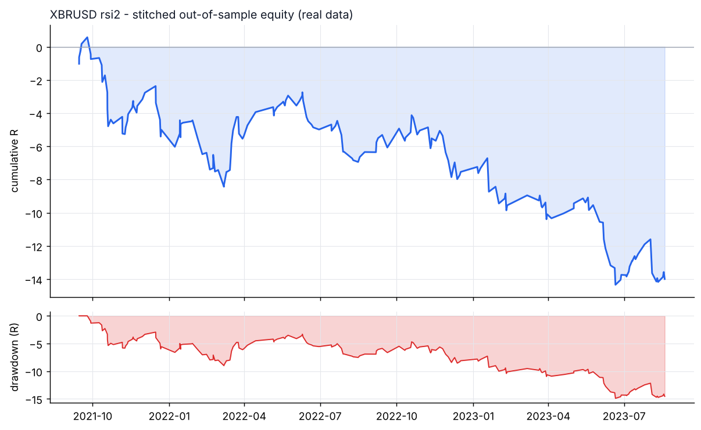
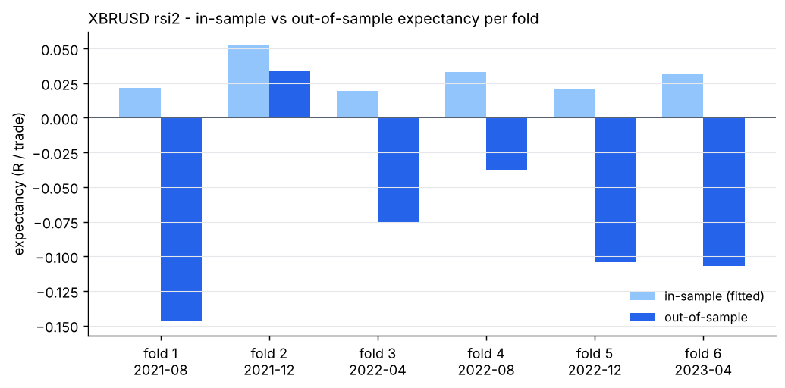

# XBRUSD - rsi2 - walk-forward result

- data: **real** - data/raw/XBRUSD/*.parquet
- span: 2019-01-02 to 2026-10-30
- folds: 6 x (train 730d / test 120d), contiguous out-of-sample coverage 720 days
- configurations evaluated: 1,800

## Targets, measured on out-of-sample data only

| Target | Required | Achieved | Result |
|---|---|---|---|
| Trades >= 100 | 100 | 191 | **PASS** |
| Profit factor >= 1.01 | 1.01 | 0.72 | FAIL |
| Win rate >= 57% | 57.0 | 56.0 | FAIL |

## Metrics

| Metric | Walk-forward OOS | Full sample (deployed params) |
|---|---|---|
| Trades | 191 | 1038 |
| Win rate % | 56.0 | 56.2 |
| Profit factor | 0.72 | 0.75 |
| Expectancy (R) | -0.073 | -0.051 |
| Avg win (R) | 0.34 | 0.27 |
| Avg loss (R) | -0.60 | -0.47 |
| Payoff | 0.57 | 0.59 |
| Total R | -14.0 | -52.9 |
| Return % | -6.6 | -22.6 |
| Max DD % | 7.3 | 22.9 |
| Max DD (R) | 14.9 | 52.6 |
| Sharpe | -2.12 | -1.33 |
| Sortino | -2.97 | -1.04 |
| CAGR % | -10.0 | -2.8 |
| Calmar | -1.37 | -0.12 |
| Trades/day | 1.12 | 0.46 |
| Avg hold (min) | 86 | 61 |
| Max consec. losses | 7 | 9 |
| t-stat of mean R | -1.82 | -3.76 |
| Friction / gross % | 13.0 | 16.1 |

- walk-forward efficiency (OOS / IS expectancy): **-2.47**
- bootstrap p-value for mean R > 0 (OOS): **0.9632**
- neighbourhood stability: 14 neighbours, median score 0.39, 100% positive

## Per-fold

```
walk-forward folds:
  1: train 2019-08-30..2021-08-29 IS  261tr +0.022R -> test 2021-08-29..2021-12-27 OOS   34tr -0.147R PF 0.58 WR 52.9%
  2: train 2019-12-28..2021-12-27 IS  185tr +0.052R -> test 2021-12-27..2022-04-26 OOS   32tr +0.033R PF 1.13 WR 68.8%
  3: train 2020-04-26..2022-04-26 IS  185tr +0.020R -> test 2022-04-26..2022-08-24 OOS   32tr -0.075R PF 0.63 WR 46.9%
  4: train 2020-08-24..2022-08-24 IS  187tr +0.033R -> test 2022-08-24..2022-12-22 OOS   32tr -0.037R PF 0.85 WR 62.5%
  5: train 2020-12-22..2022-12-22 IS  139tr +0.020R -> test 2022-12-22..2023-04-21 OOS   24tr -0.104R PF 0.63 WR 58.3%
  6: train 2021-04-21..2023-04-21 IS  269tr +0.032R -> test 2023-04-21..2023-08-19 OOS   37tr -0.107R PF 0.57 WR 48.6%
stitched OOS: trades   191 | WR  56.0% | PF  0.72 | exp -0.073R | payoff 0.57 | totR   -14.0 | ret    -6.6% | DD   7.3% | Sharpe -2.12 | t -1.82
walk-forward efficiency: -2.47
```

## Deployed parameters

```json
{
  "strategy": {
    "mode": "rsi2",
    "tf_minutes": 30,
    "session": "ny",
    "atr_period": 14,
    "atr_rank_lookback": 288,
    "atr_rank_min": 0.1,
    "atr_rank_max": 0.99,
    "sl_atr": 3.0,
    "tp_r": 0.3,
    "min_sl_points": 0.0,
    "min_sl_bp": 60,
    "allow_long": true,
    "allow_short": true,
    "er_period": 24,
    "er_min": 0.0,
    "er_max": 0.5,
    "vwap_anchor_hour": 0,
    "band_k": 2.0,
    "rsi_period": 7,
    "rsi_lo": 28.0,
    "rsi_hi": 72.0,
    "adx_period": 14,
    "adx_max": 30.0,
    "confirm_mode": 2,
    "min_dev_atr": 0.0,
    "bb_period": 48,
    "don_period": 24,
    "ema_fast": 12,
    "ema_slow": 48,
    "adx_min": 20.0,
    "expansion_mult": 1.15,
    "atr_avg_period": 48,
    "pb_slope_period": 30,
    "pb_rsi_lo": 40.0,
    "pb_rsi_hi": 60.0,
    "pb_depth_atr": 0.5,
    "pb_lookback": 6,
    "mom_period": 24,
    "mom_min_atr": 1.0,
    "mom_confirm": 1,
    "orb_hour": 7,
    "orb_bars": 4,
    "orb_buffer_atr": 0.0,
    "orb_fade": 0,
    "r2_period": 2,
    "r2_lo": 10,
    "trend_ema": 200,
    "sweep_lookback": 24,
    "sweep_wick_atr": 0.3
  },
  "execution": {
    "point": 0.001,
    "value_per_point_per_lot": 1.0,
    "min_lot": 0.01,
    "lot_step": 0.01,
    "max_lot": 50.0,
    "commission_per_lot_rt": 0.0,
    "slippage_points_entry": 5.0,
    "slippage_points_stop": 12.0,
    "swap_long_points": 0.0,
    "swap_short_points": 0.0,
    "initial_equity": 10000.0,
    "risk_pct": 0.005,
    "max_spread_points": 1000000000000.0,
    "be_trigger_r": 0.5,
    "be_offset_r": 0.1,
    "partial_r": 0.4,
    "partial_frac": 0.5,
    "trail_start_r": 0.8,
    "trail_dist_r": 1.0,
    "max_bars": 90,
    "cooldown_bars": 20,
    "max_trades_per_day": 4,
    "daily_loss_limit_r": 1000000000.0,
    "force_exit_hour": 20,
    "force_exit_min": 45,
    "compound": true
  }
}
```

## Out-of-sample breakdown

**by hour**

|   hour |   trades |   win_rate |   total_r |   exp_r |
|-------:|---------:|-----------:|----------:|--------:|
|     12 |       30 |       63.3 |      -0.7 |  -0.022 |
|     13 |       50 |       74   |       1.8 |   0.037 |
|     14 |       35 |       60   |      -0.5 |  -0.013 |
|     15 |       26 |       15.4 |     -12.7 |  -0.489 |
|     16 |       22 |       72.7 |       4.3 |   0.195 |
|     17 |       21 |       38.1 |      -3.7 |  -0.177 |
|     18 |        7 |       28.6 |      -2.6 |  -0.368 |

**by direction**

| direction   |   trades |   win_rate |   total_r |   exp_r |
|:------------|---------:|-----------:|----------:|--------:|
| long        |      111 |       57.7 |      -5.9 |  -0.053 |
| short       |       80 |       53.8 |      -8.1 |  -0.101 |

**by exit**

| exit_reason   |   trades |   win_rate |   total_r |   exp_r |
|:--------------|---------:|-----------:|----------:|--------:|
| breakeven     |       10 |      100   |       2.2 |   0.219 |
| session_close |        4 |       25   |      -0.8 |  -0.192 |
| stop_loss     |       45 |       20   |     -36   |  -0.799 |
| take_profit   |       73 |      100   |      29.6 |   0.406 |
| time_stop     |       59 |       23.7 |      -9.1 |  -0.154 |

**by year**

|   year |   trades |   win_rate |   total_r |   exp_r |
|-------:|---------:|-----------:|----------:|--------:|
|   2021 |       34 |       52.9 |      -5   |  -0.147 |
|   2022 |       96 |       59.4 |      -2.5 |  -0.026 |
|   2023 |       61 |       52.5 |      -6.5 |  -0.106 |





