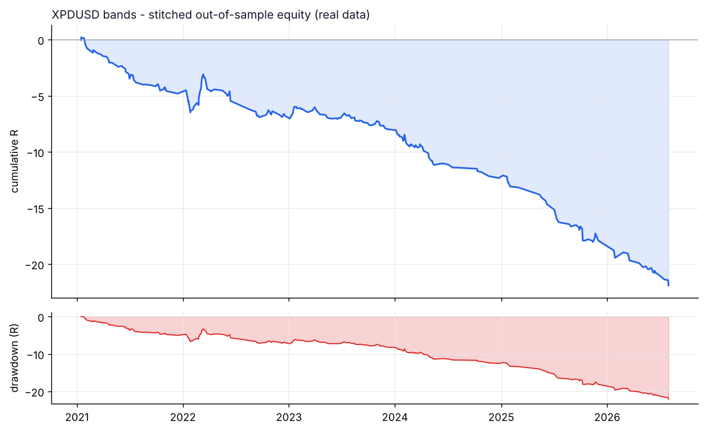
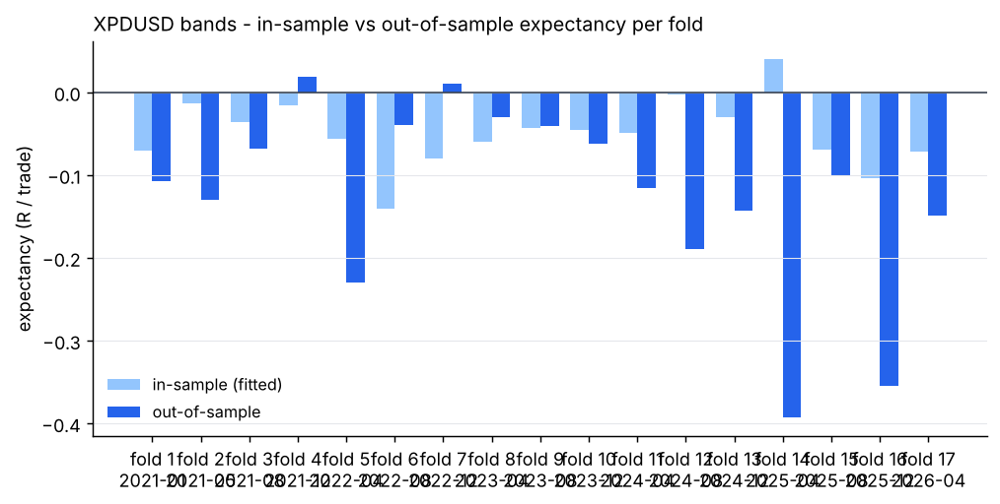
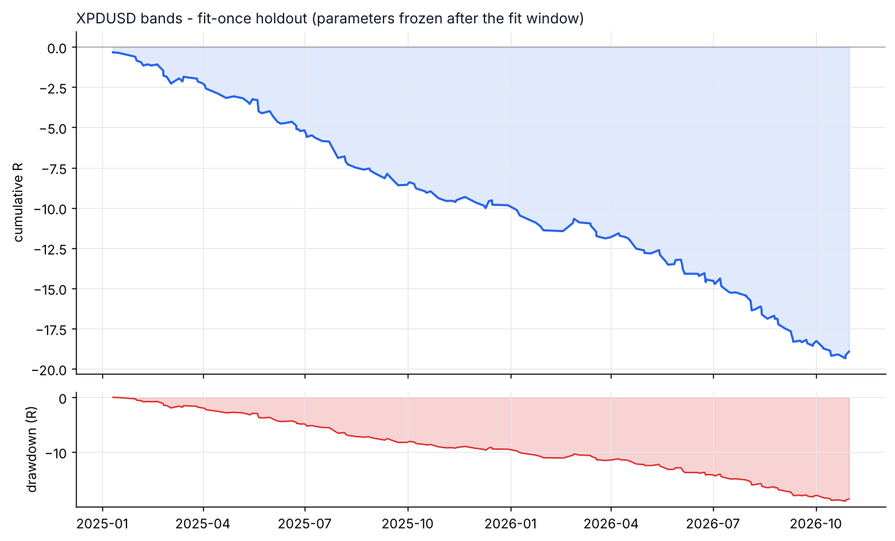

# XPDUSD - bands - walk-forward result

- data: **real** - data/raw/XPDUSD/*.parquet
- span: 2019-01-02 to 2026-10-30
- folds: 17 x (train 730d / test 120d), contiguous out-of-sample coverage 2040 days
- configurations evaluated: 6,800

## Targets, measured on out-of-sample data only

| Target | Required | Achieved | Result |
|---|---|---|---|
| Trades >= 100 | 100 | 239 | **PASS** |
| Profit factor >= 1.20 | 1.20 | 0.39 | FAIL |
| Win rate >= 50% | 50.0 | 28.9 | FAIL |

## Metrics

| Metric | Walk-forward OOS | Fit-once holdout | Full sample (deployed params) |
|---|---|---|---|
| Trades | 239 | 170 | 381 |
| Win rate % | 28.9 | 28.8 | 28.3 |
| Profit factor | 0.39 | 0.27 | 0.37 |
| Expectancy (R) | -0.092 | -0.111 | -0.105 |
| Avg win (R) | 0.20 | 0.14 | 0.22 |
| Avg loss (R) | -0.21 | -0.21 | -0.23 |
| Payoff | 0.96 | 0.66 | 0.93 |
| Total R | -21.9 | -18.9 | -40.2 |
| Return % | -16.5 | -13.9 | -39.1 |
| Max DD % | 10.5 | 14.2 | 39.2 |
| Max DD (R) | 22.1 | 19.0 | 40.1 |
| Sharpe | -5.35 | -3.79 | -2.04 |
| Sortino | -7.08 | -2.79 | -1.05 |
| CAGR % | -11.0 | -6.4 | -5.1 |
| Calmar | -1.05 | -0.45 | -0.13 |
| Trades/day | 1.01 | 0.30 | 0.16 |
| Avg hold (min) | 271 | 222 | 343 |
| Max consec. losses | 15 | 8 | 17 |
| t-stat of mean R | -5.13 | -6.71 | -7.07 |
| Friction / gross % | 34.6 | 35.9 | 30.9 |

- walk-forward efficiency (OOS / IS expectancy): **0.00**
- bootstrap p-value for mean R > 0 (OOS): **1.0000**
- neighbourhood stability: 18 neighbours, median score -46.74, 0% positive

## Cost sensitivity (fit-once holdout, parameters frozen)

| cost x | trades | win rate | PF | expectancy R | t |
|---|---|---|---|---|---|
| 0.00 | 170 | 47.1% | 0.87 | -0.011 | -0.68 |
| 0.25 | 170 | 39.4% | 0.64 | -0.036 | -2.21 |
| 0.50 | 170 | 36.5% | 0.47 | -0.061 | -3.74 |
| 0.75 | 170 | 30.6% | 0.35 | -0.086 | -5.24 |
| 1.00 | 170 | 28.8% | 0.27 | -0.111 | -6.71 |
| 1.25 | 170 | 26.5% | 0.20 | -0.136 | -8.14 |
| 1.50 | 170 | 21.8% | 0.15 | -0.162 | -9.54 |

## Per-fold

```
walk-forward folds:
  1: train 2019-01-02..2021-01-01 IS  108tr -0.070R -> test 2021-01-01..2021-05-01 OOS   19tr -0.108R PF 0.19 WR 15.8%
  2: train 2019-05-02..2021-05-01 IS   72tr -0.013R -> test 2021-05-01..2021-08-29 OOS   15tr -0.129R PF 0.20 WR 20.0%
  3: train 2019-08-30..2021-08-29 IS   78tr -0.036R -> test 2021-08-29..2021-12-27 OOS   12tr -0.068R PF 0.39 WR 25.0%
  4: train 2019-12-28..2021-12-27 IS  105tr -0.015R -> test 2021-12-27..2022-04-26 OOS   20tr +0.019R PF 1.10 WR 60.0%
  5: train 2020-04-26..2022-04-26 IS   69tr -0.056R -> test 2022-04-26..2022-08-24 OOS    8tr -0.230R PF 0.18 WR 25.0%
  6: train 2020-08-24..2022-08-24 IS   67tr -0.140R -> test 2022-08-24..2022-12-22 OOS   14tr -0.039R PF 0.69 WR 42.9%
  7: train 2020-12-22..2022-12-22 IS   86tr -0.080R -> test 2022-12-22..2023-04-21 OOS   15tr +0.010R PF 1.11 WR 46.7%
  8: train 2021-04-21..2023-04-21 IS   74tr -0.060R -> test 2023-04-21..2023-08-19 OOS   18tr -0.030R PF 0.56 WR 33.3%
  9: train 2021-08-19..2023-08-19 IS  122tr -0.043R -> test 2023-08-19..2023-12-17 OOS   19tr -0.040R PF 0.40 WR 31.6%
  10: train 2021-12-17..2023-12-17 IS  161tr -0.045R -> test 2023-12-17..2024-04-15 OOS   31tr -0.062R PF 0.40 WR 29.0%
  11: train 2022-04-16..2024-04-15 IS   90tr -0.049R -> test 2024-04-15..2024-08-13 OOS   13tr -0.115R PF 0.08 WR 15.4%
  12: train 2022-08-14..2024-08-13 IS   60tr -0.003R -> test 2024-08-13..2024-12-11 OOS    4tr -0.189R PF 0.00 WR 0.0%
  13: train 2022-12-12..2024-12-11 IS   68tr -0.030R -> test 2024-12-11..2025-04-10 OOS    7tr -0.143R PF 0.19 WR 14.3%
  14: train 2023-04-11..2025-04-10 IS   56tr +0.040R -> test 2025-04-10..2025-08-08 OOS    8tr -0.393R PF 0.00 WR 0.0%
  15: train 2023-08-09..2025-08-08 IS   89tr -0.069R -> test 2025-08-08..2025-12-06 OOS   16tr -0.100R PF 0.46 WR 31.2%
  16: train 2023-12-07..2025-12-06 IS   51tr -0.103R -> test 2025-12-06..2026-04-05 OOS    5tr -0.354R PF 0.22 WR 20.0%
  17: train 2024-04-05..2026-04-05 IS   94tr -0.071R -> test 2026-04-05..2026-08-03 OOS   15tr -0.149R PF 0.15 WR 20.0%
stitched OOS: trades   239 | WR  28.9% | PF  0.39 | exp -0.092R | payoff 0.96 | totR   -21.9 | ret   -16.5% | DD  10.5% | Sharpe -5.35 | t -5.13
walk-forward efficiency: 0.00
```

## Deployed parameters

```json
{
  "strategy": {
    "mode": "bands",
    "tf_minutes": 30,
    "session": "extended",
    "atr_period": 14,
    "atr_rank_lookback": 288,
    "atr_rank_min": 0.1,
    "atr_rank_max": 0.99,
    "sl_atr": 6.0,
    "tp_r": 0.6,
    "min_sl_points": 0.0,
    "min_sl_bp": 560,
    "allow_long": true,
    "allow_short": true,
    "er_period": 24,
    "er_min": 0.0,
    "er_max": 0.3,
    "vwap_anchor_hour": 0,
    "band_k": 2.0,
    "rsi_period": 7,
    "rsi_lo": 22,
    "rsi_hi": 78.0,
    "adx_period": 14,
    "adx_max": 100,
    "confirm_mode": 2,
    "min_dev_atr": 0.0,
    "bb_period": 96,
    "don_period": 24,
    "ema_fast": 12,
    "ema_slow": 48,
    "adx_min": 20.0,
    "expansion_mult": 1.15,
    "atr_avg_period": 48,
    "pb_slope_period": 30,
    "pb_rsi_lo": 40.0,
    "pb_rsi_hi": 60.0,
    "pb_depth_atr": 0.5,
    "pb_lookback": 6,
    "mom_period": 24,
    "mom_min_atr": 1.0,
    "mom_confirm": 1
  },
  "execution": {
    "point": 0.01,
    "value_per_point_per_lot": 1.0,
    "min_lot": 0.01,
    "lot_step": 0.01,
    "max_lot": 20.0,
    "commission_per_lot_rt": 0.0,
    "slippage_points_entry": 50.0,
    "slippage_points_stop": 120.0,
    "swap_long_points": -300.0,
    "swap_short_points": 0.0,
    "initial_equity": 10000.0,
    "risk_pct": 0.005,
    "max_spread_points": 1000000000000.0,
    "be_trigger_r": 0.0,
    "be_offset_r": 0.1,
    "partial_r": 0.6,
    "partial_frac": 0.5,
    "trail_start_r": 0.0,
    "trail_dist_r": 1.0,
    "max_bars": 480,
    "cooldown_bars": 240,
    "max_trades_per_day": 4,
    "daily_loss_limit_r": 1000000000.0,
    "force_exit_hour": 20,
    "force_exit_min": 45,
    "compound": true
  }
}
```

## Out-of-sample breakdown

**by hour**

|   hour |   trades |   win_rate |   total_r |   exp_r |
|-------:|---------:|-----------:|----------:|--------:|
|      6 |        2 |        0   |      -1.4 |  -0.723 |
|      7 |        3 |       33.3 |      -0.1 |  -0.035 |
|      8 |        6 |       33.3 |      -0.4 |  -0.062 |
|      9 |        5 |       40   |      -0.1 |  -0.02  |
|     10 |        7 |       57.1 |       0.1 |   0.011 |
|     11 |        2 |       50   |      -0.8 |  -0.389 |
|     12 |       17 |       29.4 |      -1.6 |  -0.093 |
|     13 |       35 |       34.3 |      -3.9 |  -0.111 |
|     14 |       46 |       34.8 |      -3.3 |  -0.072 |
|     15 |       40 |       22.5 |      -4.6 |  -0.114 |
|     16 |       35 |       31.4 |      -2.6 |  -0.073 |
|     17 |       31 |       19.4 |      -2.8 |  -0.09  |
|     18 |        9 |        0   |      -0.5 |  -0.055 |
|     20 |        1 |        0   |      -0   |  -0.007 |

**by direction**

| direction   |   trades |   win_rate |   total_r |   exp_r |
|:------------|---------:|-----------:|----------:|--------:|
| long        |      121 |       31.4 |     -11   |  -0.091 |
| short       |      118 |       26.3 |     -10.9 |  -0.092 |

**by exit**

| exit_reason   |   trades |   win_rate |   total_r |   exp_r |
|:--------------|---------:|-----------:|----------:|--------:|
| session_close |      158 |       27.8 |     -11.2 |  -0.071 |
| stop_loss     |        4 |        0   |      -4.1 |  -1.022 |
| take_profit   |        2 |      100   |       1.6 |   0.8   |
| time_stop     |       75 |       30.7 |      -8.2 |  -0.109 |

**by year**

|   year |   trades |   win_rate |   total_r |   exp_r |
|-------:|---------:|-----------:|----------:|--------:|
|   2021 |       46 |       19.6 |      -4.8 |  -0.104 |
|   2022 |       42 |       47.6 |      -2   |  -0.048 |
|   2023 |       53 |       35.8 |      -1.2 |  -0.023 |
|   2024 |       48 |       22.9 |      -4.3 |  -0.089 |
|   2025 |       30 |       20   |      -5.6 |  -0.186 |
|   2026 |       20 |       20   |      -4   |  -0.2   |






