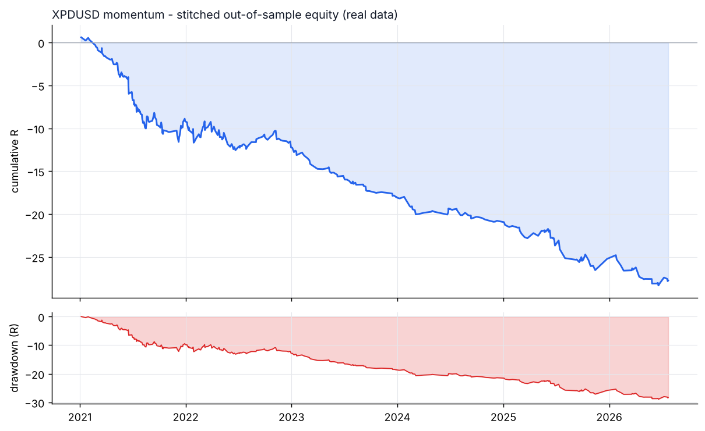
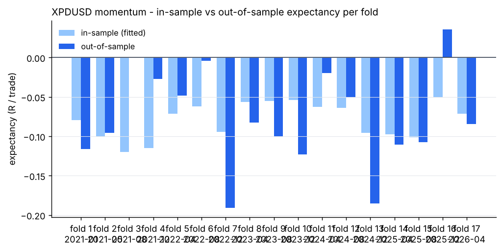
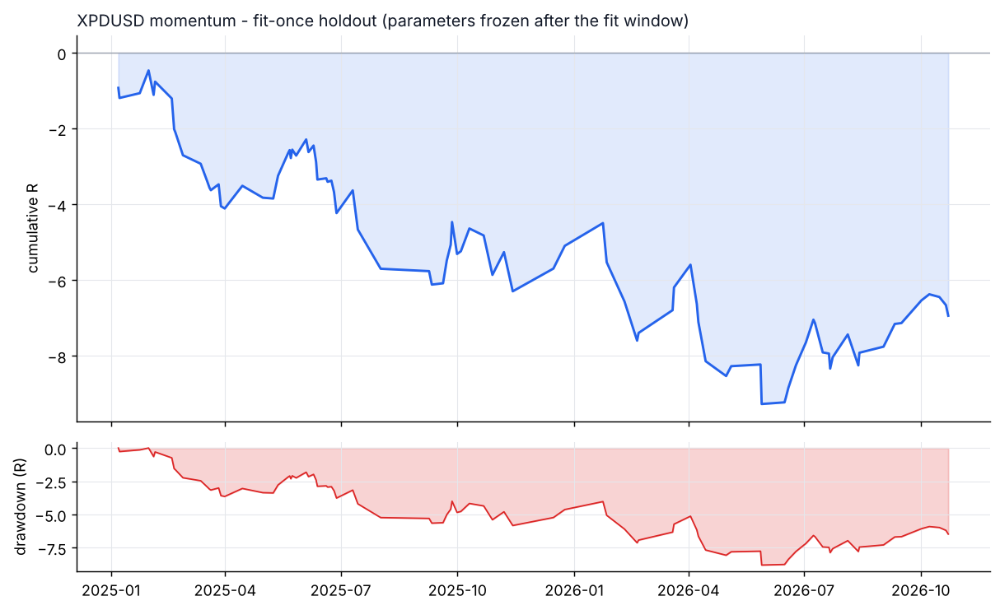

# XPDUSD - momentum - walk-forward result

- data: **real** - data/raw/XPDUSD/*.parquet
- span: 2019-01-02 to 2026-10-30
- folds: 17 x (train 730d / test 120d), contiguous out-of-sample coverage 2040 days
- configurations evaluated: 6,800

## Targets, measured on out-of-sample data only

| Target | Required | Achieved | Result |
|---|---|---|---|
| Trades >= 100 | 100 | 371 | **PASS** |
| Profit factor >= 1.20 | 1.20 | 0.55 | FAIL |
| Win rate >= 50% | 50.0 | 38.8 | FAIL |

## Metrics

| Metric | Walk-forward OOS | Fit-once holdout | Full sample (deployed params) |
|---|---|---|---|
| Trades | 371 | 92 | 459 |
| Win rate % | 38.8 | 48.9 | 34.9 |
| Profit factor | 0.55 | 0.71 | 0.40 |
| Expectancy (R) | -0.075 | -0.075 | -0.092 |
| Avg win (R) | 0.23 | 0.37 | 0.18 |
| Avg loss (R) | -0.27 | -0.50 | -0.23 |
| Payoff | 0.87 | 0.74 | 0.75 |
| Total R | -27.7 | -6.9 | -42.1 |
| Return % | -26.3 | -3.2 | -41.1 |
| Max DD % | 13.5 | 4.3 | 41.4 |
| Max DD (R) | 28.9 | 8.8 | 42.4 |
| Sharpe | -3.74 | -0.86 | -1.88 |
| Sortino | -5.66 | -0.44 | -1.12 |
| CAGR % | -9.0 | -1.4 | -5.4 |
| Calmar | -0.67 | -0.33 | -0.13 |
| Trades/day | 1.00 | 0.16 | 0.19 |
| Avg hold (min) | 303 | 406 | 236 |
| Max consec. losses | 8 | 8 | 20 |
| t-stat of mean R | -4.41 | -1.36 | -7.35 |
| Friction / gross % | 31.4 | 27.4 | 34.3 |

- walk-forward efficiency (OOS / IS expectancy): **0.00**
- bootstrap p-value for mean R > 0 (OOS): **1.0000**
- neighbourhood stability: 18 neighbours, median score -21.49, 0% positive

## Cost sensitivity (fit-once holdout, parameters frozen)

| cost x | trades | win rate | PF | expectancy R | t |
|---|---|---|---|---|---|
| 0.00 | 92 | 62.0% | 1.32 | +0.060 | 1.12 |
| 0.25 | 92 | 60.9% | 1.15 | +0.030 | 0.56 |
| 0.50 | 92 | 55.4% | 1.00 | +0.001 | 0.02 |
| 0.75 | 92 | 51.1% | 0.80 | -0.048 | -0.86 |
| 1.00 | 92 | 48.9% | 0.71 | -0.075 | -1.36 |
| 1.25 | 92 | 45.6% | 0.60 | -0.111 | -1.98 |
| 1.50 | 92 | 41.3% | 0.51 | -0.149 | -2.61 |

## Per-fold

```
walk-forward folds:
  1: train 2019-01-02..2021-01-01 IS  108tr -0.080R -> test 2021-01-01..2021-05-01 OOS   22tr -0.116R PF 0.37 WR 22.7%
  2: train 2019-05-02..2021-05-01 IS  430tr -0.100R -> test 2021-05-01..2021-08-29 OOS   70tr -0.096R PF 0.38 WR 32.9%
  3: train 2019-08-30..2021-08-29 IS  135tr -0.120R -> test 2021-08-29..2021-12-27 OOS   29tr -0.001R PF 1.00 WR 44.8%
  4: train 2019-12-28..2021-12-27 IS  136tr -0.115R -> test 2021-12-27..2022-04-26 OOS   34tr -0.027R PF 0.87 WR 47.1%
  5: train 2020-04-26..2022-04-26 IS  153tr -0.071R -> test 2022-04-26..2022-08-24 OOS   29tr -0.049R PF 0.69 WR 48.3%
  6: train 2020-08-24..2022-08-24 IS  163tr -0.062R -> test 2022-08-24..2022-12-22 OOS   21tr -0.004R PF 0.96 WR 47.6%
  7: train 2020-12-22..2022-12-22 IS  169tr -0.095R -> test 2022-12-22..2023-04-21 OOS   16tr -0.191R PF 0.18 WR 18.8%
  8: train 2021-04-21..2023-04-21 IS  160tr -0.056R -> test 2023-04-21..2023-08-19 OOS   22tr -0.083R PF 0.27 WR 40.9%
  9: train 2021-08-19..2023-08-19 IS  153tr -0.055R -> test 2023-08-19..2023-12-17 OOS   13tr -0.100R PF 0.08 WR 23.1%
  10: train 2021-12-17..2023-12-17 IS  140tr -0.054R -> test 2023-12-17..2024-04-15 OOS   16tr -0.123R PF 0.20 WR 37.5%
  11: train 2022-04-16..2024-04-15 IS  119tr -0.063R -> test 2024-04-15..2024-08-13 OOS   14tr -0.020R PF 0.81 WR 50.0%
  12: train 2022-08-14..2024-08-13 IS  102tr -0.064R -> test 2024-08-13..2024-12-11 OOS   13tr -0.050R PF 0.49 WR 38.5%
  13: train 2022-12-12..2024-12-11 IS   85tr -0.095R -> test 2024-12-11..2025-04-10 OOS   11tr -0.185R PF 0.07 WR 18.2%
  14: train 2023-04-11..2025-04-10 IS   97tr -0.097R -> test 2025-04-10..2025-08-08 OOS   21tr -0.110R PF 0.53 WR 42.9%
  15: train 2023-08-09..2025-08-08 IS   94tr -0.101R -> test 2025-08-08..2025-12-06 OOS   13tr -0.107R PF 0.52 WR 46.2%
  16: train 2023-12-07..2025-12-06 IS   97tr -0.051R -> test 2025-12-06..2026-04-05 OOS    9tr +0.035R PF 1.16 WR 55.6%
  17: train 2024-04-05..2026-04-05 IS   81tr -0.072R -> test 2026-04-05..2026-08-03 OOS   18tr -0.084R PF 0.42 WR 44.4%
stitched OOS: trades   371 | WR  38.8% | PF  0.55 | exp -0.075R | payoff 0.87 | totR   -27.7 | ret   -26.3% | DD  13.5% | Sharpe -3.74 | t -4.41
walk-forward efficiency: 0.00
```

## Deployed parameters

```json
{
  "strategy": {
    "mode": "momentum",
    "tf_minutes": 5,
    "session": "london",
    "atr_period": 14,
    "atr_rank_lookback": 288,
    "atr_rank_min": 0.1,
    "atr_rank_max": 0.99,
    "sl_atr": 4.0,
    "tp_r": 0.6,
    "min_sl_points": 0.0,
    "min_sl_bp": 560,
    "allow_long": true,
    "allow_short": true,
    "er_period": 24,
    "er_min": 0.6,
    "er_max": 1.0,
    "vwap_anchor_hour": 0,
    "band_k": 2.0,
    "rsi_period": 7,
    "rsi_lo": 28.0,
    "rsi_hi": 72.0,
    "adx_period": 14,
    "adx_max": 30.0,
    "confirm_mode": 2,
    "min_dev_atr": 0.0,
    "bb_period": 48,
    "don_period": 24,
    "ema_fast": 12,
    "ema_slow": 48,
    "adx_min": 20.0,
    "expansion_mult": 1.15,
    "atr_avg_period": 48,
    "pb_slope_period": 30,
    "pb_rsi_lo": 40.0,
    "pb_rsi_hi": 60.0,
    "pb_depth_atr": 0.5,
    "pb_lookback": 6,
    "mom_period": 12,
    "mom_min_atr": 2.5,
    "mom_confirm": 1
  },
  "execution": {
    "point": 0.01,
    "value_per_point_per_lot": 1.0,
    "min_lot": 0.01,
    "lot_step": 0.01,
    "max_lot": 20.0,
    "commission_per_lot_rt": 0.0,
    "slippage_points_entry": 50.0,
    "slippage_points_stop": 120.0,
    "swap_long_points": -300.0,
    "swap_short_points": 0.0,
    "initial_equity": 10000.0,
    "risk_pct": 0.005,
    "max_spread_points": 1000000000000.0,
    "be_trigger_r": 0.7,
    "be_offset_r": 0.1,
    "partial_r": 0.6,
    "partial_frac": 0.5,
    "trail_start_r": 1.0,
    "trail_dist_r": 1.0,
    "max_bars": 240,
    "cooldown_bars": 60,
    "max_trades_per_day": 2,
    "daily_loss_limit_r": 1000000000.0,
    "force_exit_hour": 20,
    "force_exit_min": 45,
    "compound": true
  }
}
```

## Out-of-sample breakdown

**by hour**

|   hour |   trades |   win_rate |   total_r |   exp_r |
|-------:|---------:|-----------:|----------:|--------:|
|      6 |       13 |       53.8 |      -0.7 |  -0.054 |
|      7 |       94 |       34   |     -11.8 |  -0.126 |
|      8 |       91 |       45.1 |      -5.9 |  -0.065 |
|      9 |       37 |       40.5 |      -0.5 |  -0.014 |
|     10 |       38 |       50   |      -1.6 |  -0.043 |
|     11 |       46 |       45.7 |      -0   |  -0     |
|     12 |       19 |       10.5 |      -3   |  -0.156 |
|     13 |       11 |       18.2 |      -1.9 |  -0.169 |
|     14 |        8 |       37.5 |      -0.3 |  -0.039 |
|     15 |        7 |       28.6 |      -1.1 |  -0.163 |
|     16 |        2 |        0   |      -0.2 |  -0.117 |
|     17 |        2 |        0   |      -0.3 |  -0.151 |
|     18 |        1 |        0   |      -0.1 |  -0.097 |
|     19 |        1 |        0   |      -0.1 |  -0.112 |
|     20 |        1 |        0   |      -0.1 |  -0.114 |

**by direction**

| direction   |   trades |   win_rate |   total_r |   exp_r |
|:------------|---------:|-----------:|----------:|--------:|
| long        |      191 |       35.1 |     -21   |  -0.11  |
| short       |      180 |       42.8 |      -6.7 |  -0.037 |

**by exit**

| exit_reason   |   trades |   win_rate |   total_r |   exp_r |
|:--------------|---------:|-----------:|----------:|--------:|
| session_close |       22 |       22.7 |      -1.4 |  -0.064 |
| stop_loss     |        4 |        0   |      -4.1 |  -1.027 |
| take_profit   |       19 |      100   |      11.4 |   0.6   |
| time_stop     |      326 |       36.8 |     -33.6 |  -0.103 |

**by year**

|   year |   trades |   win_rate |   total_r |   exp_r |
|-------:|---------:|-----------:|----------:|--------:|
|   2021 |      124 |       33.9 |      -9.2 |  -0.074 |
|   2022 |       83 |       48.2 |      -3   |  -0.037 |
|   2023 |       52 |       30.8 |      -5.8 |  -0.111 |
|   2024 |       40 |       40   |      -2.8 |  -0.069 |
|   2025 |       46 |       39.1 |      -4.4 |  -0.096 |
|   2026 |       26 |       46.2 |      -2.5 |  -0.097 |






