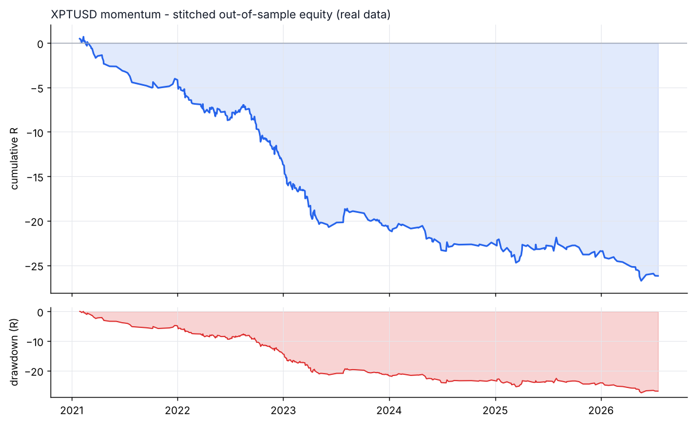
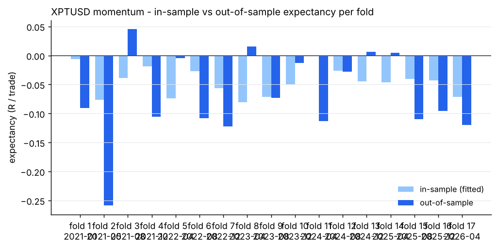
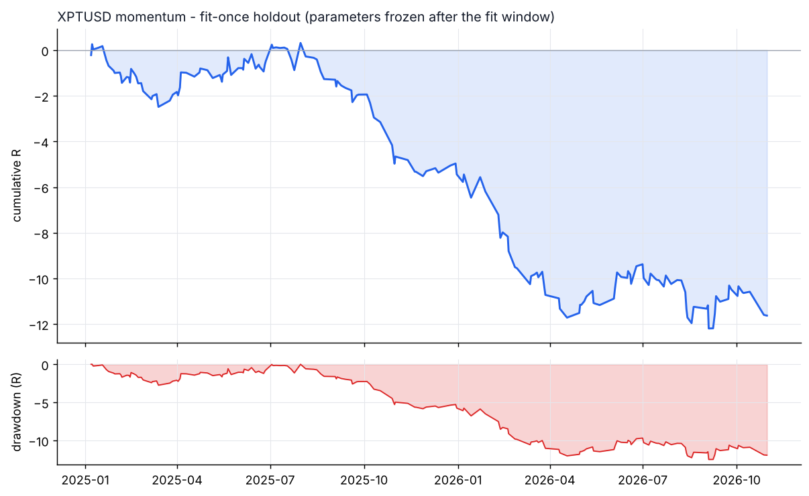

# XPTUSD - momentum - walk-forward result

- data: **real** - data/raw/XPTUSD/*.parquet
- span: 2019-01-02 to 2026-10-30
- folds: 17 x (train 730d / test 120d), contiguous out-of-sample coverage 2040 days
- configurations evaluated: 6,800

## Targets, measured on out-of-sample data only

| Target | Required | Achieved | Result |
|---|---|---|---|
| Trades >= 100 | 100 | 365 | **PASS** |
| Profit factor >= 1.20 | 1.20 | 0.55 | FAIL |
| Win rate >= 50% | 50.0 | 38.6 | FAIL |

## Metrics

| Metric | Walk-forward OOS | Fit-once holdout | Full sample (deployed params) |
|---|---|---|---|
| Trades | 365 | 174 | 355 |
| Win rate % | 38.6 | 40.2 | 33.5 |
| Profit factor | 0.55 | 0.64 | 0.47 |
| Expectancy (R) | -0.072 | -0.067 | -0.076 |
| Avg win (R) | 0.22 | 0.30 | 0.20 |
| Avg loss (R) | -0.26 | -0.31 | -0.21 |
| Payoff | 0.87 | 0.96 | 0.93 |
| Total R | -26.2 | -11.6 | -26.9 |
| Return % | -10.8 | -7.2 | -10.9 |
| Max DD % | 12.9 | 8.4 | 11.7 |
| Max DD (R) | 27.5 | 12.5 | 27.8 |
| Sharpe | -3.66 | -1.47 | -1.45 |
| Sortino | -5.50 | -1.05 | -0.69 |
| CAGR % | -8.7 | -3.3 | -1.2 |
| Calmar | -0.67 | -0.39 | -0.10 |
| Trades/day | 1.00 | 0.30 | 0.15 |
| Avg hold (min) | 265 | 407 | 230 |
| Max consec. losses | 14 | 7 | 12 |
| t-stat of mean R | -4.30 | -2.21 | -5.07 |
| Friction / gross % | 27.3 | 21.4 | 30.3 |

- walk-forward efficiency (OOS / IS expectancy): **0.00**
- bootstrap p-value for mean R > 0 (OOS): **1.0000**
- neighbourhood stability: 18 neighbours, median score -27.29, 0% positive

## Cost sensitivity (fit-once holdout, parameters frozen)

| cost x | trades | win rate | PF | expectancy R | t |
|---|---|---|---|---|---|
| 0.00 | 174 | 52.9% | 1.13 | +0.018 | 0.60 |
| 0.25 | 174 | 51.7% | 0.99 | -0.001 | -0.04 |
| 0.50 | 174 | 48.3% | 0.86 | -0.023 | -0.74 |
| 0.75 | 174 | 45.4% | 0.73 | -0.047 | -1.56 |
| 1.00 | 174 | 40.2% | 0.64 | -0.067 | -2.21 |
| 1.25 | 174 | 36.8% | 0.55 | -0.092 | -3.02 |
| 1.50 | 174 | 35.1% | 0.49 | -0.111 | -3.62 |

## Per-fold

```
walk-forward folds:
  1: train 2019-01-02..2021-01-01 IS   87tr -0.006R -> test 2021-01-01..2021-05-01 OOS   26tr -0.091R PF 0.44 WR 30.8%
  2: train 2019-05-02..2021-05-01 IS   93tr -0.076R -> test 2021-05-01..2021-08-29 OOS    8tr -0.259R PF 0.00 WR 0.0%
  3: train 2019-08-30..2021-08-29 IS   94tr -0.039R -> test 2021-08-29..2021-12-27 OOS    9tr +0.045R PF 1.32 WR 66.7%
  4: train 2019-12-28..2021-12-27 IS   88tr -0.018R -> test 2021-12-27..2022-04-26 OOS   31tr -0.105R PF 0.41 WR 25.8%
  5: train 2020-04-26..2022-04-26 IS  220tr -0.074R -> test 2022-04-26..2022-08-24 OOS   42tr -0.005R PF 0.95 WR 50.0%
  6: train 2020-08-24..2022-08-24 IS  275tr -0.027R -> test 2022-08-24..2022-12-22 OOS   51tr -0.108R PF 0.35 WR 31.4%
  7: train 2020-12-22..2022-12-22 IS  320tr -0.056R -> test 2022-12-22..2023-04-21 OOS   52tr -0.122R PF 0.33 WR 40.4%
  8: train 2021-04-21..2023-04-21 IS  111tr -0.080R -> test 2023-04-21..2023-08-19 OOS   19tr +0.016R PF 1.14 WR 47.4%
  9: train 2021-08-19..2023-08-19 IS   99tr -0.072R -> test 2023-08-19..2023-12-17 OOS   21tr -0.073R PF 0.26 WR 23.8%
  10: train 2021-12-17..2023-12-17 IS   76tr -0.050R -> test 2023-12-17..2024-04-15 OOS   16tr -0.013R PF 0.86 WR 56.2%
  11: train 2022-04-16..2024-04-15 IS  115tr -0.001R -> test 2024-04-15..2024-08-13 OOS   16tr -0.113R PF 0.53 WR 37.5%
  12: train 2022-08-14..2024-08-13 IS   84tr -0.026R -> test 2024-08-13..2024-12-11 OOS    7tr -0.027R PF 0.57 WR 57.1%
  13: train 2022-12-12..2024-12-11 IS  114tr -0.045R -> test 2024-12-11..2025-04-10 OOS   17tr +0.006R PF 1.03 WR 64.7%
  14: train 2023-04-11..2025-04-10 IS   96tr -0.046R -> test 2025-04-10..2025-08-08 OOS   17tr +0.005R PF 1.03 WR 41.2%
  15: train 2023-08-09..2025-08-08 IS  100tr -0.041R -> test 2025-08-08..2025-12-06 OOS    9tr -0.109R PF 0.40 WR 44.4%
  16: train 2023-12-07..2025-12-06 IS   80tr -0.043R -> test 2025-12-06..2026-04-05 OOS   11tr -0.096R PF 0.49 WR 36.4%
  17: train 2024-04-05..2026-04-05 IS   83tr -0.071R -> test 2026-04-05..2026-08-03 OOS   13tr -0.120R PF 0.34 WR 15.4%
stitched OOS: trades   365 | WR  38.6% | PF  0.55 | exp -0.072R | payoff 0.87 | totR   -26.2 | ret   -10.8% | DD  12.9% | Sharpe -3.66 | t -4.30
walk-forward efficiency: 0.00
```

## Deployed parameters

```json
{
  "strategy": {
    "mode": "momentum",
    "tf_minutes": 5,
    "session": "ny",
    "atr_period": 14,
    "atr_rank_lookback": 288,
    "atr_rank_min": 0.1,
    "atr_rank_max": 0.99,
    "sl_atr": 4.0,
    "tp_r": 1.0,
    "min_sl_points": 0.0,
    "min_sl_bp": 352,
    "allow_long": true,
    "allow_short": true,
    "er_period": 24,
    "er_min": 0.6,
    "er_max": 1.0,
    "vwap_anchor_hour": 0,
    "band_k": 2.0,
    "rsi_period": 7,
    "rsi_lo": 28.0,
    "rsi_hi": 72.0,
    "adx_period": 14,
    "adx_max": 30.0,
    "confirm_mode": 2,
    "min_dev_atr": 0.0,
    "bb_period": 48,
    "don_period": 24,
    "ema_fast": 12,
    "ema_slow": 48,
    "adx_min": 20.0,
    "expansion_mult": 1.15,
    "atr_avg_period": 48,
    "pb_slope_period": 30,
    "pb_rsi_lo": 40.0,
    "pb_rsi_hi": 60.0,
    "pb_depth_atr": 0.5,
    "pb_lookback": 6,
    "mom_period": 48,
    "mom_min_atr": 3.5,
    "mom_confirm": 1
  },
  "execution": {
    "point": 0.01,
    "value_per_point_per_lot": 1.0,
    "min_lot": 0.01,
    "lot_step": 0.01,
    "max_lot": 20.0,
    "commission_per_lot_rt": 0.0,
    "slippage_points_entry": 20.0,
    "slippage_points_stop": 50.0,
    "swap_long_points": -200.0,
    "swap_short_points": 0.0,
    "initial_equity": 10000.0,
    "risk_pct": 0.005,
    "max_spread_points": 1000000000000.0,
    "be_trigger_r": 0.0,
    "be_offset_r": 0.1,
    "partial_r": 0.6,
    "partial_frac": 0.5,
    "trail_start_r": 1.0,
    "trail_dist_r": 1.0,
    "max_bars": 240,
    "cooldown_bars": 240,
    "max_trades_per_day": 1,
    "daily_loss_limit_r": 1000000000.0,
    "force_exit_hour": 20,
    "force_exit_min": 45,
    "compound": true
  }
}
```

## Out-of-sample breakdown

**by hour**

|   hour |   trades |   win_rate |   total_r |   exp_r |
|-------:|---------:|-----------:|----------:|--------:|
|      7 |       85 |       37.6 |      -7.2 |  -0.084 |
|      8 |       45 |       42.2 |      -2.4 |  -0.054 |
|      9 |       40 |       27.5 |      -5.5 |  -0.138 |
|     10 |       48 |       43.8 |      -2.1 |  -0.044 |
|     11 |       45 |       51.1 |      -1.4 |  -0.032 |
|     12 |       21 |       19   |      -3.8 |  -0.18  |
|     13 |       20 |       40   |      -1.8 |  -0.092 |
|     14 |       18 |       38.9 |      -1.4 |  -0.08  |
|     15 |       21 |       47.6 |       1   |   0.047 |
|     16 |       11 |       27.3 |      -0.7 |  -0.066 |
|     17 |       11 |       27.3 |      -0.7 |  -0.065 |

**by direction**

| direction   |   trades |   win_rate |   total_r |   exp_r |
|:------------|---------:|-----------:|----------:|--------:|
| long        |      201 |       37.3 |     -18.9 |  -0.094 |
| short       |      164 |       40.2 |      -7.3 |  -0.045 |

**by exit**

| exit_reason   |   trades |   win_rate |   total_r |   exp_r |
|:--------------|---------:|-----------:|----------:|--------:|
| session_close |       32 |       37.5 |      -2.7 |  -0.084 |
| stop_loss     |        3 |        0   |      -3.1 |  -1.021 |
| take_profit   |       11 |      100   |       7.9 |   0.718 |
| time_stop     |      319 |       37   |     -28.3 |  -0.089 |

**by year**

|   year |   trades |   win_rate |   total_r |   exp_r |
|-------:|---------:|-----------:|----------:|--------:|
|   2021 |       44 |       31.8 |      -4.2 |  -0.094 |
|   2022 |      127 |       36.2 |      -9.5 |  -0.075 |
|   2023 |       92 |       39.1 |      -7.2 |  -0.078 |
|   2024 |       36 |       50   |      -1.6 |  -0.044 |
|   2025 |       45 |       51.1 |      -1   |  -0.021 |
|   2026 |       21 |       19   |      -2.8 |  -0.134 |






