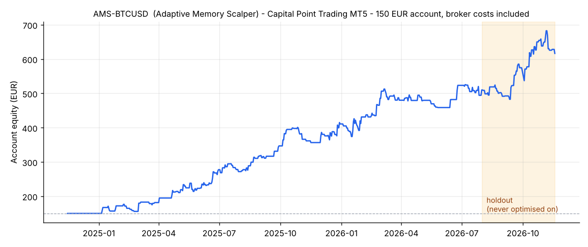

# AMS-BTCUSD: results report (2026-11-19)

**Strategy:** Adaptive Memory Scalper for BTCUSD at Capital Point Trading (MT5), 150 € account.
**Data:** Bitstamp BTC/USD 1-minute bars (a real USD market), 2024-11-01 → 2026-11-18.
**Costs:** $30 spread + $5 slippage on stops, about 20%/yr swap on both sides, 0.01-lot minimum, 1:20 leverage, 80% margin cap.

> These are assumed broker conditions. Run `mt5/export_btcusd.py` on your PC to replace them with the exact values from your terminal, then re-run (see `mt5/README.md`).

## Final strategy

| | |
|---|---|
| Signal | 15-minute bar closes with a 1-bar move of at least 2.7 × ATR(14). The trade follows the impulse (momentum ignition). |
| Exits | Stop 2.0 × ATR, target 7.5 × ATR, time stop 3 h (12 bars). Typical stop is $300–600. |
| Memory | Every signal opens a shadow (paper) trade. Its result in R updates an exponentially weighted (α = 0.1) expectancy per cell: direction × 7-day momentum state. After 5 results, a cell is vetoed while its expectancy is below −0.3R. The memory is rebuilt from history on start-up and saved to disk. |
| Adaptation | Thresholds and exits scale with volatility (ATR). The memory switches off directions or regimes that stop working and re-enables them when shadow results recover. |
| Small account | Risk 2% per trade. If that is below the broker's 0.01-lot minimum, the minimum lot is used only if its stop risk is ≤ 5% of equity; otherwise the trade is skipped. A margin check is applied. |

## Results (150 € start, all costs included)

| Period | Trades | Profit factor | Sharpe (ann.) | PF×Sharpe balance¹ | Return | Max DD |
|---|---|---|---|---|---|---|
| Development 2024-11-15 → 2026-08-01 | 225 | 1.54 | 2.33 | 1.12 | +240% | 11.7% |
| **Holdout 2026-08-01 → 2026-11-19 (forward test)** | **57** | **1.52** | **2.42** | **1.12** | **+34.7%** (150 → 202 €) | **12.9%** |
| Full 2 years | 280 | 1.51 | 2.28 | 1.08 | +311% (150 → 617 €) | 11.7% |

¹ The optimisation objective: √((PF−1) × Sharpe). It rewards strategies that are good on both metrics.

**Every quarter was profitable** (PF per quarter): 2.41 · 2.15 · 1.43 · 2.24 · 1.45 · 1.23 · 1.47 · 1.52 (the last one is the holdout).

**Cost stress test, holdout:**

| Spread / slippage | PF | Sharpe | Return |
|---|---|---|---|
| $30 / $5 (base) | 1.52 | 2.42 | +34.7% |
| $50 / $5 | 1.23 | 1.28 | +14.8% |
| $75 / $15 | 1.17 | 0.91 | +9.0% |

The strategy depends on costs. If your real BTCUSD spread is well above $50, the edge mostly disappears.

**Trade profile (full period):** 11.6 trades/month, median hold about 2.5 h, 132 long / 148 short, 45% win rate. Average loss on a stop is −1.8% of equity; average win is +3.1%. Exits: 119 stops, 30 targets, 131 time stops. The longest losing streak was 10 trades.

## How it was found: the optimisation loop

| Round | What was tried | Out-of-sample outcome |
|---|---|---|
| v1–v2 | Mean reversion + breakout, regime switch, memory; 24 params re-optimised per fold | PF 0.73, overfit |
| Edge scan | 6 signal families × timeframes, before costs vs after | Only **impulse continuation** on 10–30 m bars survives the spread; ≤ 5 m scalping loses in every variant |
| v3–v5 | 6-family "council" picked by memory | Memory can't rescue negative-expectancy families |
| v6–v7 | Small spaces, walk-forward re-optimisation, ensembles, several seeds | Frequent re-optimisation chases noise (PF 0.75–1.06) |
| Trade analysis | Serial correlation, trend alignment, sessions, volume | Trade outcomes are not autocorrelated, so the memory works as a regime-keyed veto, not a streak filter |
| Final | One optimisation on dev (quarterly-consistency objective, plateau/neighbour selection, 4 seeds × 600 trials), then the memory veto chosen on dev, then **one** holdout run | Table above |

The first round used BTCUSDT with Capital.com costs and is archived in `results/round1_capital_com/`. It switched to BTC/USD and Capital Point Trading after your correction.

## Honest caveats

- **The minimum lot sets the risk.** With 150 € the broker's 0.01-lot minimum (about $600–1,000 notional) means each trade risks 2–4% of the account until equity grows. Losing streaks of 10 happened. Expect 15–25% drawdowns live, not 12%.
- **Data mismatch.** The backtest uses Bitstamp prices; Capital Point's feed, spread and swap will differ. Re-run on the broker's own export before going live.
- **"Scalping".** Signals are on 15-minute bars and holds are 1–3 hours. True 1–5-minute scalping could not beat the spread in any test.
- **Short holdout.** 3.6 months and 57 trades is real evidence, but not proof. Run the EA on demo for 4–6 weeks first.
- **EA not compiled here.** The MQL5 code mirrors the Python engine, and the Python live logic is verified against the backtest (`tests/test_live_consistency.py`). The EA itself still needs compiling in MetaEditor and a Strategy Tester run on your PC.
